# ATUL0012345 – Sentinel Policy-as-Code for Digital Sovereignty & IaC Supply Chain Security

> ATU – IaC for DevOps Pipelines – Terraform Sentinel Assignment 2026
> Student: L00205332 · Organisation: ATUL0012345
> Repository: https://github.com/L00205332/ATUL0012345-sentinel-sovereignty

**Status:** ✅ **Complete.** All deliverables are in this repository: Terraform code with `tfplan` and lock file, six Sentinel policies with 57 tests, evidence from seven live scenarios (§6), the decision justification (§7) and the one-page [technical report](documentation/technical-report/technical-report.pdf).

> 🤖 **AI tool usage is declared.** This project was built with Claude Code (Claude Opus 5.5). **Every prompt used is logged verbatim in [`prompts.md`](prompts.md)**, with a short note on what the AI did for each one. The declaration and the student's own contribution are in [§8](#8-declaration-of-ai-tool-usage).

---

## 1. Purpose

This repository contains a Policy-as-Code (PaC) framework built with **Terraform** and **HashiCorp Sentinel**, integrated with **HCP Terraform (Free tier)**. It blocks non-compliant AWS infrastructure **before it is applied**, in three areas:

1. **Digital sovereignty:** workloads and data stay in approved (Irish/EU) jurisdictions.
2. **IaC supply chain security:** only trusted, pinned providers and modules are used.
3. **Infrastructure security:** baseline EC2, storage and network hardening.

Context: Ireland signed the *Declaration for European Digital Sovereignty* (2025). In the Dáil debate of 13 May 2026, "Digital Security & Resilience" was named a key priority for Ireland's EU Council presidency.

## 2. Repository structure


```
.
├── README.md                          ✅
├── prompts.md                         ✅ LLM usage log (declared as required by the brief)
├── .github/workflows/
│   └── terraform-checks.yml           ✅ CI: fmt, validate, sentinel test, bundle tests; deploys policies on main
├── documentation/
│   ├── evidence/                      ✅ 27 screenshots (shown in README §6) + test-results.md index
│   └── technical-report/              ✅ technical-report.md + .pdf (1 A4 page) + build-report.ps1
├── iam/
│   └── hcp-terraform-policy.json      ✅ least-privilege policy for the HCP Terraform IAM user
├── scripts/
│   ├── build-bundle.ps1               ✅ merges mandatory policies into ONE hard-mandatory bundle + bundle tests
│   ├── make-tfplan.ps1                ✅ local empty-state plan → terraform/tfplan + tfplan.txt
│   ├── upload-policies.ps1            ✅ clean-tree check → tests → bundle → deploy to HCP via API (git commit recorded)
│   ├── destroy.ps1                    ✅ destroy run via HCP API → confirm → wait → audit
│   └── audit-regions.ps1              ✅ leftovers in EU regions + off-region drift (us-east-1)
├── sentinel/
│   ├── sentinel.hcl                   ✅ every policy + its enforcement level (drives the bundle)
│   ├── network.sentinel               ✅
│   ├── sovereignty.sentinel           ✅
│   ├── supply_chain.sentinel          ✅
│   ├── instance_type.sentinel         ✅ advisory
│   ├── encryption.sentinel            ✅
│   ├── metadata.sentinel              ✅
│   ├── mocks/compliant-baseline/      ✅ REAL mocks downloaded from HCP run run-Xz7zmhMJKXVNHwa3
│   ├── mocks/offregion-snapshot/      ✅ REAL mocks from the blocked PR #9 run run-kwQg5XK3EGXKwPTs (redacted)
│   └── test/<policy>/                 ✅ all six policies: *.hcl test cases + mock-*.sentinel
├── terraform/
│   ├── versions.tf                    ✅ Terraform/provider constraints + HCP cloud block
│   ├── providers.tf                   ✅ AWS provider (eu-west-1) + default tags
│   ├── variables.tf / outputs.tf      ✅
│   ├── network.tf                     ✅ pinned registry VPC module + security group (no ingress)
│   ├── main.tf                        ✅ KMS key, SSM role, EC2 (IMDSv2, encrypted root)
│   ├── storage.tf                     ✅ sensitive data volume (encrypted, tagged)
│   ├── backup.tf                      ✅ snapshot (eu-west-1) → encrypted DR copy (eu-central-1)
│   ├── .terraform.lock.hcl            ✅ hashicorp/aws 6.72.0, checksums for linux_amd64 + windows_amd64
│   ├── tfplan                         ✅ saved plan (binary), produced by scripts/make-tfplan.ps1
│   └── tfplan.txt                     ✅ readable output of the same plan (23 to add)
├── tests/test-scenarios.md            ✅ index: test layers, live scenarios, coverage per policy
├── .gitignore                         ✅ state, .terraform/, tfvars excluded
└── .gitattributes                     ✅ LF line endings (HCP and CI run on Linux)
```

**Why tests live in `sentinel/test/` and not `tests/`:** `sentinel test` discovers test cases in `test/<policy_name>/` next to the policy file. Keeping them there means `sentinel test` runs with no extra configuration, locally and in CI. The brief's `tests/` folder holds the human-readable scenario list instead.

## 3. Prerequisites

| Tool | Purpose | Verified version |
|------|---------|------------------|
| Terraform CLI | Write and plan infrastructure | 1.17.1 |
| Sentinel CLI | Run policy tests locally against mocks | 0.41.0 |
| AWS CLI | Credentials / account context | 2.13.25 |
| Git + GitHub CLI | Version control, public repo | git 2.56.0 / gh 2.103.3 |
| HCP Terraform (Free) | Remote runs + policy set enforcement | Org `L00205332`, Free tier (1 policy set) |
| AWS account | Real resources (plan + apply) | $10/month budget alert in place |

## 4. Design

### 4.0 The infrastructure under test (`terraform/`)

A deliberately small but realistic stack. Every resource exists to exercise at least one policy:

| Resource | Region | Exercises |
|---|---|---|
| VPC (`terraform-aws-modules/vpc/aws` **6.0.0**), 1 public subnet, locked-down default SG | eu-west-1 | supply chain (module source + pinned version), sovereignty |
| Security group: **no ingress**, egress 443/tcp only | eu-west-1 | network |
| EC2 `t3.micro`, Amazon Linux 2023, IMDSv2 required (hop limit 1), encrypted root disk | eu-west-1 | instance_type, metadata, encryption, sovereignty |
| IAM role + instance profile for SSM Session Manager | global (IAM) | administrative access without SSH |
| Customer-managed KMS keys (rotation on, 7-day deletion window) | eu-west-1 + eu-central-1 | encryption, sovereignty (key control) |
| Data volume, tagged `data_classification = sensitive` | eu-west-1 | encryption, data residency |
| Snapshot of the data volume | eu-west-1 | backups |
| Encrypted snapshot **copy** (DR) | eu-central-1 | replication inside the EU |

Design decisions:
1. **One provider, per-resource `region`.** AWS provider v6 lets a resource set `region` itself, so the DR resources use `region = var.dr_region` instead of a second aliased provider. The region of each resource then appears directly in the plan, which keeps the sovereignty policy simple and hard to bypass.
2. **Customer-managed keys per region.** The DR copy is encrypted with a key that lives in Frankfurt, so a copy never depends on a key outside its own jurisdiction. Deleting the keys makes every copy unreadable (crypto-shredding).
3. **No SSH at all.** Admin access goes through SSM Session Manager: IAM-authenticated, logged, and no inbound port. That's why the security group has no ingress rules.
4. **Cost.** One AZ, no NAT gateway, a 1 GiB data volume and a t3.micro. This costs a few cents per test cycle, and every stack is destroyed after testing.
5. **Global services.** IAM is global, not regional. The sovereignty policy has to exempt it explicitly, which is itself a limitation of region-based controls (see 7.2).

### 4.1 Digital sovereignty

Region model, enforced by [`sentinel/sovereignty.sentinel`](sentinel/sovereignty.sentinel) ✅ (hard-mandatory):

| Region | Role | Policy result |
|---|---|---|
| `eu-west-1` (Dublin) | Primary: compute, network, data | ✅ Allowed |
| `eu-central-1` (Frankfurt) | EU disaster recovery: **backup copies only** (e.g. EBS snapshot copies) | ✅ Allowed for backups, ❌ for compute |
| `us-east-1` / any other | Outside EU jurisdiction | ❌ Denied (hard-mandatory) |

- **Test case:** an EBS snapshot copy to `us-east-1` must be denied at plan time.
- **Drift demonstration:** the same copy made manually with the AWS CLI (outside Terraform) is *not* seen by Sentinel. `scripts/audit-regions.ps1` detects it and flags it as off-region drift, which shows why sovereignty needs controls beyond plan-time policy.
- **Administrative access:** no SSH. Admin access goes through AWS SSM Session Manager (audited, no open port).
- **Defence in depth (IAM):** the HCP Terraform IAM user ([`iam/hcp-terraform-policy.json`](iam/hcp-terraform-policy.json)) can only call EC2 and KMS when `aws:RequestedRegion` is `eu-west-1` or `eu-central-1`. Even if a Sentinel policy were missing or overridden, AWS itself would refuse to create anything in `us-east-1` for that identity. Sentinel stops a non-compliant plan before it runs; IAM stops the API call if it ever runs anyway.
- **Pipeline identity scoped:** that user can create IAM roles and instance profiles only with the `atul0012345-sentinel-sovereignty-` name prefix. It can attach only `AmazonSSMManagedInstanceCore`, and can pass the role only to EC2. This stops it from escalating its own privileges.

#### Sovereignty policy rules

| Rule | Enforces | Brief requirement |
|---|---|---|
| `resources_in_approved_regions` | Every AWS resource being created or updated is in `eu-west-1` or `eu-central-1`. A resource with no region must be a known global service (`aws_iam_*`, `aws_cloudfront_*`, `aws_route53_*`, `aws_organizations_*`). A region unknown at plan time fails (fail safe) | Restrict deployments to approved geographical regions |
| `dr_region_backup_only` | Frankfurt may only hold backup copies and their keys (`aws_ebs_snapshot_copy`, `aws_kms_key`, `aws_kms_alias`, `aws_kms_replica_key`, `aws_backup_vault`), no compute, network or primary data | Backups |
| `sensitive_data_resident` | Resources tagged `data_classification = sensitive` have their primary copy in Ireland; only backup copies may be in the DR region | Data residency for sensitive information |
| `replication_targets_approved` | Services that copy data elsewhere stay in the EU: DLM `cross_region_copy_rule.target_region`, AWS Backup `copy_action.destination_vault_arn` (region read from the ARN) | Data replication and backups |
| `no_external_admin_trust` | IAM role trust policies may only trust AWS **service** principals: no other AWS account, federated identity or `"*"` | Administrative access |

Design decisions:
1. **Region from the plan.** AWS provider v6 records `region` on every regional resource, even when the code doesn't set it (confirmed on the real plan: 20/20 regional resources). So the policy reads `change.after.region` and doesn't have to work out provider aliases.
2. **Two layers for sensitive data.** Rules 1 and 3 overlap on purpose. In a mutation test where `us-east-1` was wrongly added to `approved_regions`, Rule 3 still blocked the sensitive snapshot copy.
3. **Deletes and data sources are ignored.** Removing an off-region resource must never be blocked, and reading a data source stores nothing.
4. **Non-AWS providers are skipped** (e.g. `random_id`). Which providers may be used at all is the supply-chain policy's job.
5. **All rules always evaluated.** `main` uses `all [rule1, rule2, ...]` instead of `rule1 and rule2`. Sentinel's `and` short-circuits, so the output would only show the *first* failing rule; now a policy check lists every violation at once. This was found because tests that checked later rules failed until the change, and the same change was applied to `network.sentinel`.

**How jurisdictional restrictions contribute to sovereignty:** keeping compute, data, backups and keys inside Irish and EU regions keeps the data under EU law (GDPR, the NIS2 / Digital Security & Resilience agenda highlighted for Ireland's EU presidency) and Irish regulatory oversight. Disaster recovery stays inside the same legal area (Frankfurt), and customer-managed keys held per region mean the organisation, not the provider, decides who can decrypt each copy. Restricting role trust to AWS services keeps administrative control inside the organisation's own account.

What region rules cannot guarantee (jurisdiction, out-of-band copies, global services, region-less data flows) is discussed in [7.2](#72-limitations-of-region-based-data-residency-controls).

### 4.2 IaC supply chain security

Controls in the Terraform code itself, re-checked on every run by `supply_chain.sentinel` (below):

| Layer | Control | Where |
|---|---|---|
| Terraform core | `required_version = ">= 1.17.0, < 2.0.0"` | `versions.tf` |
| Provider source | `hashicorp/aws` only (official publisher on registry.terraform.io) | `versions.tf` |
| Provider version | `~> 6.0`: patch/minor updates allowed, never a new major version | `versions.tf` |
| Provider integrity | Exact version + SHA-256 checksums for Linux (HCP runners) and Windows (local) | `.terraform.lock.hcl` |
| Module provenance | Only `terraform-aws-modules/*` from the public registry, with an **exact** version (`6.0.0`) | `network.tf` |
| AMI provenance | Image ID resolved from AWS's own public SSM parameter, never hard-coded | `main.tf` |

Validation result (`terraform init -backend=false` + `terraform validate`):
- `hashicorp/aws` resolved to **v6.72.0**, "signed by HashiCorp": the CLI verified the provider's GPG signature before installing it.
- The lock file records the **combined** constraint `">= 5.79.0, ~> 6.0"`. The `>= 5.79.0` part comes from the VPC module, not from our code. **Modules bring their own dependency constraints**, so reviewing a module means reviewing its dependencies too.
- `terraform validate`: *Success! The configuration is valid.*

#### Supply chain policy: [`sentinel/supply_chain.sentinel`](sentinel/supply_chain.sentinel) ✅ (hard-mandatory, in the bundle)

| Rule | Enforces | Reads |
|---|---|---|
| `providers_from_approved_sources` | Every provider that is **configured or used** comes from an approved source (`registry.terraform.io/hashicorp/aws`). Look-alike sources such as `hashicorp-aws/aws` fail | `tfconfig/v2` providers **and** `tfplan/v2` `provider_name` of every resource and data source |
| `provider_versions_approved` | Each configured provider uses an approved constraint (`~> 6.0`). A missing or open-ended constraint (`>= 5.0`) fails | `tfconfig/v2` providers |
| `modules_from_trusted_sources` | Modules come from an approved registry namespace (`terraform-aws-modules/`) or a local path. Git, HTTP, S3 and other `::` / `://` sources fail | `tfconfig/v2` module_calls (nested calls included) |
| `modules_pinned` | Registry modules use an **exact** version (`6.0.0` / `= 6.0.0`), never a range or no version | `tfconfig/v2` module_calls |
| `terraform_version_approved` | The plan was produced by an approved Terraform core (`1.17.*`) | `tfplan/v2` `terraform_version` |

Design decisions:
1. **The configuration *and* the plan.** A resource can use a provider with no `provider` block at all (Terraform adds it implicitly). Only the plan's `provider_name` shows it. A mutation test that removed the plan check let `fail-implicit-provider` through.
2. **Modules must be pinned exactly; providers may use `~> 6.0`.** Providers are locked to an exact version **and SHA-256 checksums** in `.terraform.lock.hcl`, so a `~>` range in the code is safe: upgrades only happen when someone runs `terraform init -upgrade` and commits a new lock file. **Modules aren't in the lock file at all.** A range like `~> 6.0` would silently pull new module code on the next `init`, so for modules the exact pin in the code is the only control.
3. **Parameters for the approved lists** (`sc_approved_providers`, `sc_approved_module_prefixes`, `sc_approved_terraform_prefixes`). Approving a new provider or module namespace is a reviewed one-line change.

**Supply chain risks this policy cannot address** (see 7.3):

| Risk | Why Sentinel can't see it | What covers it instead |
|---|---|---|
| A tampered or substituted provider **binary** | Sentinel sees source addresses, not files | `.terraform.lock.hcl` checksums for Linux and Windows, plus HashiCorp's GPG signature, checked by the CLI ("signed by HashiCorp") |
| **What a module's code requires or does** (e.g. the VPC module's own `>= 5.79.0` provider requirement, or a malicious resource inside a trusted module) | `tfconfig/v2` lists only *our* calls, not the module's internals | Code review of the module version before approving it; the resources it creates are still checked by the other policies |
| A **compromised maintainer, registry or release** of an approved namespace | A trusted name doesn't guarantee trusted content | Exact pinning (an upgrade needs review), a private registry with vetted copies, monitoring of advisories |
| Moving targets outside Terraform's dependency model, e.g. the **"latest" AMI** SSM parameter (scenario 5) | It's a data value, not a provider or module | Pinning the image, or `ignore_changes` |
| Compromise of **this repository, the CI or HCP** (stolen token, malicious merge, edited policies) | The policies themselves run on that platform | Branch protection, reviews, least-privilege tokens, the commit recorded in each deployed policy |

### 4.3 Infrastructure security

#### Network: [`sentinel/network.sentinel`](sentinel/network.sentinel) ✅

| Rule | Blocks | Why |
|---|---|---|
| `no_public_ssh` | SSH (22/tcp) reachable from `0.0.0.0/0` or `::/0`, including via port ranges or "all protocols" (`-1`) | Brief requirement: no unrestricted inbound SSH. Admin access uses SSM instead. |
| `public_ingress_restricted` | Any internet-facing ingress that is not a single approved TCP port (default `443`) | "Appropriate network security": blocks RDP, database ports, wide ranges and all-traffic rules. |

Design decisions:
1. **Three resource types checked.** AWS ingress can be written as `aws_vpc_security_group_ingress_rule`, as an inline `ingress` block on `aws_security_group`, or as a legacy `aws_security_group_rule`. Checking only one would let a change of resource type bypass the policy. All three are normalised into one shape before evaluation.
2. **Fail safe.** A TCP rule with missing ports, or protocol `-1`/`all`, is treated as "all ports".
3. **Deletes ignored.** Removing a rule can only reduce exposure, and its planned `after` value is `null`.
4. **Unknown values.** A CIDR not known at plan time (computed from another resource) is not treated as the internet. This is a known limitation of plan-time checks (see 7.4).
5. **Configurable.** `param public_ingress_ports` can be changed in `sentinel.hcl` without editing the policy.
6. **Egress out of scope.** Outbound allow-all is the AWS default, and the brief targets inbound access.

#### Encryption: [`sentinel/encryption.sentinel`](sentinel/encryption.sentinel) ✅ (hard-mandatory, in the bundle)

| Rule | Enforces |
|---|---|
| `ebs_encrypted` | `aws_ebs_volume`, `aws_ebs_snapshot_copy`, the instance `root_block_device` and `ebs_block_device`, and launch template EBS mappings are explicitly `encrypted`. An instance without a `root_block_device` fails (fail safe) |
| `ebs_customer_managed_key` | The same disks set a **customer-managed** `kms_key_id` in the code: a reference to a key, or a key ARN, never an `alias/aws/…` AWS-managed key |

Design decisions:
1. **Two imports, because the plan can't tell the keys apart.** In the real plan, `kms_key_id` is *unknown* for a key created in the same run. If no key is set at all, AWS also fills one in at apply time, so it's unknown too. Only `tfconfig/v2` shows whether a key was written in the code (`references: ["aws_kms_key.primary.arn"]`), so the encryption check uses `tfplan` and the key check uses `tfconfig`.
2. **Explicit encryption only.** The account setting "EBS encryption by default" is invisible to Sentinel, so it isn't relied on.
3. **Snapshots are covered through their volume.** An `aws_ebs_snapshot`'s `encrypted` is unknown at plan time (inherited); the DR **copy** sets its own key and is checked directly.
4. **Why customer-managed keys:** they serve sovereignty as well as security. The organisation owns the key policy, the key stays in its region, and scheduling deletion makes every copy unreadable.

#### IMDSv2: [`sentinel/metadata.sentinel`](sentinel/metadata.sentinel) ✅ (hard-mandatory, in the bundle)

| Rule | Enforces |
|---|---|
| `imdsv2_required` | `aws_instance` and `aws_launch_template` have `http_tokens = "required"`, or the metadata endpoint is disabled. A **missing `metadata_options` block fails**, because AWS would then allow IMDSv1 |
| `imds_hop_limit_restricted` | `http_put_response_hop_limit` ≤ 1 (`param md_max_hop_limit`), so containers or proxies on the host cannot get tokens |

**Why:** IMDSv1 answers any HTTP GET. A server-side request forgery bug in an application can therefore read the instance role's temporary credentials. IMDSv2 requires a PUT to get a session token first, which an SSRF normally can't do. Some newer AMIs default to IMDSv2, but that's an AMI property Sentinel can't see, so the policy requires it explicitly.

#### Instance types: [`sentinel/instance_type.sentinel`](sentinel/instance_type.sentinel) ✅ (**advisory**, separate policy)

| Rule | Enforces |
|---|---|
| `instance_types_approved` | `aws_instance` / `aws_launch_template` type in `t3.micro`, `t3.small`, `t3a.micro`, `t3a.small` (`param it_approved_types`). An unknown type warns (fail safe); a launch template without a type is allowed |

**Why advisory:** it's a cost and standards control, not a security boundary. HCP Free allows only one mandatory policy, which the bundle uses, so it also demonstrates a second enforcement level. The output says `WARN`, and the run continues.

#### Bundle-readiness
All three new policies prefix every top-level name (`enc_`, `md_`, `it_`), including loop variables. Sentinel `for` loops at the top level have no scope of their own, so a loop variable in one policy could silently overwrite a value with the same name in another bundled policy. `build-bundle.ps1` now checks for that too.

### 4.4 Enforcement levels

Levels are set per policy in `sentinel.hcl` (✅ = built):

| Policy | Level in `sentinel.hcl` | Deployed on HCP Free as | Reason |
|---|---|---|---|
| sovereignty ✅ | hard-mandatory | part of **`atul0012345-guardrails`** (hard-mandatory) | Legal/jurisdictional requirement, no override |
| network ✅ | hard-mandatory | part of `atul0012345-guardrails` | Public SSH is a direct attack surface |
| supply_chain ✅ | hard-mandatory | part of `atul0012345-guardrails` | An untrusted provider or module can compromise everything |
| encryption ✅ | hard-mandatory | part of `atul0012345-guardrails` | Data protection baseline |
| metadata (IMDSv2) ✅ | hard-mandatory | part of `atul0012345-guardrails` | Blocks credential theft via SSRF |
| instance_type ✅ | **advisory** | separate advisory policy | Cost/standards control: warns, doesn't block |

**Why one bundled policy:** HCP Free allows **only one mandatory policy per organisation** (`403: The organization has reached the limit of 1 mandatory policy`). Making only sovereignty mandatory would have left the infrastructure security controls as warnings. Instead, `scripts/build-bundle.ps1` merges every mandatory policy into one hard-mandatory policy, so **all of them block**.
- The repo keeps one file per control area, each with its own tests, matching the brief's structure.
- Each `FAIL` line in the output still names the original rule, e.g. `FAIL sensitive_data_resident: …`.

**Trade-offs of bundling:**
- **One enforcement level for all bundled controls.** Soft-mandatory with a per-control override isn't possible, so `instance_type` was planned as soft-mandatory and is now **advisory**. It still demonstrates a second enforcement level.
- **An override would cover everything.** On a paid tier the same `sentinel.hcl` would deploy the policies separately, each at its own level.

**How the bundle is built and checked (`build-bundle.ps1`):**
1. Imports are deduplicated, and every `param` is moved to the top, because Sentinel requires params before any statement. The first build failed on exactly this.
2. Each policy's body is copied without its `main`, and a single `main = all [every rule]` is generated.
3. Two policies defining the same top-level name stop the build (name-clash check).
4. **Bundle tests** are generated from each policy's own tests:
   - fail cases must be rejected for the same rules
   - synthetic pass cases must keep that policy's rules true
   - **real-plan** cases (`pass-real*`) must pass the whole bundle
   
   Result: 36/36 PASS (4 bundled policies, 11 rules).
5. Tests that don't mock an import the bundle uses (e.g. network tests have no `tfconfig/v2`) get an empty mock for it, and a loop variable that reuses another policy's top-level name stops the build.

## 5. How to run

### Run the Sentinel tests locally

```bash
cd sentinel
sentinel test -verbose          # all policies
sentinel test -run network      # one policy
```

A test case passes when the policy returns the result the test expects. So `fail.hcl` **passing** means the policy correctly **rejected** the non-compliant mock.

### Git workflow
- Feature work: branch → PR → review → merge to `main`. Once HCP is connected, a merge to `main` triggers a real plan → policy check → apply.
- Non-compliant tests: a branch + PR per violation. HCP runs a speculative plan, the policy check fails (❌ on the PR), and the PR is closed without merging.

### Validate the Terraform code locally (no AWS or HCP needed)

```bash
cd terraform
terraform init -backend=false     # downloads the provider + module, skips HCP
terraform fmt -check
terraform validate
terraform providers lock -platform=linux_amd64 -platform=windows_amd64
```

The last command records checksums for both the HCP runners (Linux) and local Windows in `.terraform.lock.hcl`. Without the Linux hashes, HCP would not be able to verify the provider it downloads.

### HCP Terraform setup

| Setting | Value | Why |
|---|---|---|
| Organisation | `L00205332` | Free tier |
| Workspace | `atul0012345-sovereignty`, VCS-driven from this repo | Every merge to `main` plans; every PR gets a speculative plan + policy check |
| Working directory | `terraform` | The Terraform root inside the repo |
| Terraform version | 1.17.1 | Matches local CLI and lock file |
| Apply method | Manual | A human confirms every apply after seeing the policy result |
| AWS credentials | `AWS_ACCESS_KEY_ID`, `AWS_SECRET_ACCESS_KEY` as **sensitive environment variables** | Static keys: an accepted trade-off (long-lived secret held by a SaaS; OIDC dynamic credentials would be better in production), mitigated by a dedicated least-privilege, region-restricted IAM user whose keys are deleted after grading |
| Policy set | `atul0012345-sovereignty-policies`, scoped to the workspace only, Platform execution mode (Sentinel 0.40.x), no UI parameters | The single Free-tier policy set. It holds the **`atul0012345-guardrails`** bundle (hard-mandatory) plus any advisory policies, all **individually managed** and deployed by `scripts/upload-policies.ps1` through the HCP Policies API |

**HCP Free limits found during setup (each one shaped the design):**

| Limit | Found when | Error | Response |
|---|---|---|---|
| 1 policy set | creating the set | "You have 1 policy set left" | One set for the workspace |
| 0 **versioned** policy sets | uploading `sentinel/` as a version | `403 … limit of 0 versioned policy sets` | Individually managed policies, created through the API |
| 1 **mandatory** policy | deploying the second hard-mandatory policy | `403 … limit of 1 mandatory policy` | All mandatory policies bundled into one (see 4.4) |

**Policy deployment flow:** policy PR → review → merge to `main` → `scripts/upload-policies.ps1`:
1. **Refuses uncommitted changes** under `sentinel/`, and writes the **git commit** into each policy's HCP description. You can always trace which code HCP is enforcing.
2. Runs `sentinel test` on the separate policies.
3. Builds the bundle and runs the bundle tests (`build-bundle.ps1`).
4. Policies in HCP that the repo no longer deploys are listed, and **deleted only with `-RemoveStale`**.
5. Creates or updates the bundle (hard-mandatory) and each advisory policy, attaches them to the set and uploads the code.

`-DryRun` does steps 1–3 without any API call.

Consequences:
- **Drift risk:** if the script isn't run after a merge, HCP keeps enforcing the old code. The commit in the description makes that visible, and the CI `deploy-policies` job now runs the script automatically on every merge to `main` once the `TFE_TOKEN` secret is set (see the CI section below and 7.5).
- **Bundle-ready policies:** no shared modules or `sentinel.hcl` params; each file has its imports at the top, a final `main`, and unique top-level names.
- **No UI parameters:** parameters could be set in the policy set UI, but that would change policy behaviour without any Git history, so none are used.
- **Version gap:** HCP Platform mode runs Sentinel **0.40.x**, while local tests use **0.41.0**. The policies use only long-standing language features, and the first HCP policy check confirms they behave the same.

### Destroy / cleanup

```bash
powershell -ExecutionPolicy Bypass -File .\scripts\destroy.ps1 -AwsProfile atu
```

The workspace is VCS-driven, so `terraform destroy` from the CLI is not allowed. The script queues a destroy run through the HCP API, asks you to type the workspace name to confirm, waits for the apply, and then runs `audit-regions.ps1`. KMS keys go into a 7-day `PendingDeletion` state (an AWS minimum) and are not reported as leftovers.

Audit only (e.g. for the drift demo):

```bash
powershell -ExecutionPolicy Bypass -File .\scripts\audit-regions.ps1 -AwsProfile atu
```

### After the assignment is graded
1. Run `scripts/destroy.ps1` and confirm the audit reports CLEAN.
2. Delete the HCP IAM user's access keys, then the user (`aws iam delete-access-key`, `aws iam delete-user-policy`, `aws iam delete-user`).
3. Delete the `AWS_*` variables from the HCP workspace.

### The `tfplan` deliverable

```bash
powershell -ExecutionPolicy Bypass -File .\scripts\make-tfplan.ps1 -AwsProfile atu
```

Real plans for this project run **in HCP Terraform** (the `cloud` block), so `terraform plan -out=tfplan` in `terraform/` doesn't produce a normal plan file. Downloading HCP's plan would describe the *running* stack instead, including the AWS account ID in every ARN. `make-tfplan.ps1` therefore plans **the same code** locally:
1. It copies `terraform/` into a temporary folder.
2. A Terraform override file there replaces the `cloud` block with an **empty local state**.
3. It runs `terraform plan -out=tfplan` and `terraform show`.
4. It copies the files back: `terraform/tfplan` (binary) and `terraform/tfplan.txt` (readable).

The result is **"Plan: 23 to add, 0 to change, 0 to destroy"**, the same compliant stack as the first HCP run. Both files were scanned before committing: no account ID, no access keys, no public IPs, and only `eu-west-1` / `eu-central-1` regions. The binary also records the code it was planned from, which includes the temporary local-backend override.

### Continuous integration (`.github/workflows/terraform-checks.yml`)

Runs on every PR and every push to `main` that touches `terraform/`, `sentinel/`, `scripts/` or the workflow:

| Job | Checks |
|---|---|
| `terraform` | `terraform fmt -check`, `terraform init -backend=false` (verifies the provider against the lock-file checksums), `terraform validate` |
| `sentinel` | installs Sentinel **0.41.0** checksum-verified, `sentinel fmt -check`, `sentinel test` (all 57 cases), then builds the bundle and runs the 53 bundle tests |
| `deploy-policies` | **on `main` only**, after both jobs pass: runs `upload-policies.ps1` with the `TFE_TOKEN` repository secret. This removes the manual "remember to upload" step (the drift risk in 5 / 7.5). It's skipped with a notice until the secret is added |

The pipeline is itself part of the supply chain, so:
- **Actions are pinned to full commit SHAs** (`actions/checkout@3d3c42e…` v7.0.1, `hashicorp/setup-terraform@dfe3c3f…` v4.0.1), not to movable tags.
- **The Sentinel binary's SHA-256 is hard-coded** from HashiCorp's published `SHA256SUMS`.
- **The workflow token is read-only**, and the HCP token is only exposed to the deploy job on `main`.

HCP Terraform still runs the real plan and policy check for each PR; CI adds the fast static checks and the policy unit tests as a second status check.

**First CI run (PR #23):** both CI jobs ✅ and HCP's check ✅, with `deploy-policies` correctly skipped on a PR. The log shows `sentinel.zip: OK` (checksum verified) and 110 `PASS` lines (57 policy + 53 bundle tests) on a Linux runner.

<a href="documentation/evidence/40-ci-and-hcp-checks-passed.png">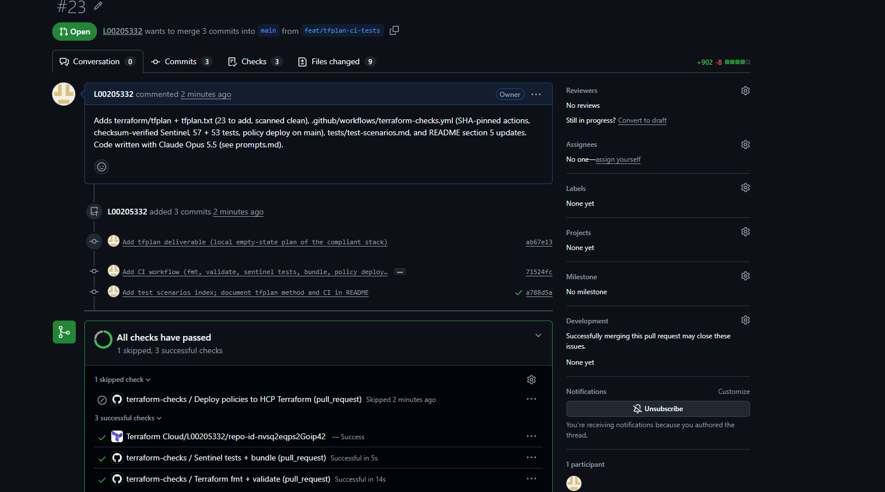</a>

**To enable automatic policy deployment** (optional): in HCP, create a **team API token** for a team with "Manage policies" (or a user token), and add it on GitHub under **Settings → Secrets and variables → Actions** as `TFE_TOKEN`.

## 6. Testing and evidence

Every claim in this section is backed by a screenshot in [`documentation/evidence/`](documentation/evidence/); click any image to open it at full size.

**Redaction:** the AWS account ID is blacked out in the two audit screenshots. Screenshots showing IAM access key IDs were not included.

### 6.1 Summary

| # | Scenario | Change | Expected | Actual |
|---|---|---|---|---|
| 0 | [Local mock tests](#610-local-mock-tests-sentinel-test) | — | all pass | ✅ **57/57** policy tests, **53/53** bundle tests |
| 1 | [Compliant baseline](#63-scenario-1-compliant-baseline-applied) | `main` | policies pass, apply allowed | ✅ passed; 23 resources applied |
| 2 | [Sovereignty: DR copy outside the EU (PR #9)](#64-scenario-2-dr-copy-outside-the-eu-pr-9-blocked) | `dr_region = "us-east-1"` | **blocked** | ⛔ hard failed: `resources_in_approved_regions` ×3, `sensitive_data_resident` |
| 3 | [Unencrypted EBS volume (PR #12)](#65-scenario-3-unencrypted-ebs-volume-pr-12-blocked) | `encrypted = false` | **blocked** | ⛔ hard failed: `ebs_encrypted` |
| 4 | [IMDSv1 allowed (PR #13)](#66-scenario-4-imdsv1-allowed-pr-13-blocked-and-a-policy-bug-found) | `http_tokens = "optional"` | **blocked** | ⛔ hard failed: `imdsv2_required` (the first run also exposed a policy bug, now fixed) |
| 5 | [Advisory: `t3.large` (PR #17)](#67-scenario-5-advisory-t3large) | `instance_type = "t3.large"` | **warn, not blocked** | ⚠️ advisory warning only; run **not** blocked, GitHub check green. Also exposed an unpinned-AMI replacement risk |
| 6 | [Drift: manual `us-east-1` copy](#68-scenario-6-drift-manual-off-region-copy) | AWS CLI, outside Terraform | Sentinel can't see it; the audit flags `DRIFT` | 🔎 HCP: +0 ~0 −0, **2/2 policies passed**; audit: **`DRIFT`** detected → copy deleted → clean |
| 7 | [Supply chain: unpinned module (PR #21)](#69-scenario-7-unpinned-module-pr-21-blocked) | VPC module `6.0.0` → `~> 6.0` | **blocked** | ⛔ hard failed: `modules_pinned`; the plan itself succeeded |

**How a non-compliant change is prevented:**
1. Every change reaches `main` only through a PR. HCP runs a speculative plan for the PR and evaluates it against the policy set, and GitHub shows the result as a status check.
2. `atul0012345-guardrails` is **hard-mandatory**: a failure can't be overridden, and the run ends *Errored*, so it can't be applied.
3. A merge to `main` triggers a normal run, which is evaluated again before any apply, and every apply also needs manual confirmation.
4. **Outside Sentinel:** the HCP IAM user can only call EC2/KMS in the two EU regions, so even an apply that got through would be refused by AWS in `us-east-1`. The gap: without branch protection, a failed check doesn't stop the *merge* (found in scenario 3).

### 6.2 Platform limits and HCP integration

HCP Terraform Free imposed three limits that shaped the design (see 4.4 and 5): one policy set, no VCS-linked (versioned) policy sets, and **one mandatory policy**. That's why all mandatory policies are bundled into `atul0012345-guardrails` and deployed through the API.

| One policy set | No VCS-linked policy sets |
|---|---|
| <a href="documentation/evidence/01-free-tier-1-policy-set.png">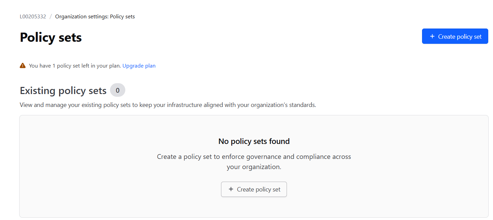</a> | <a href="documentation/evidence/03-free-tier-no-vcs-policy-sets.png">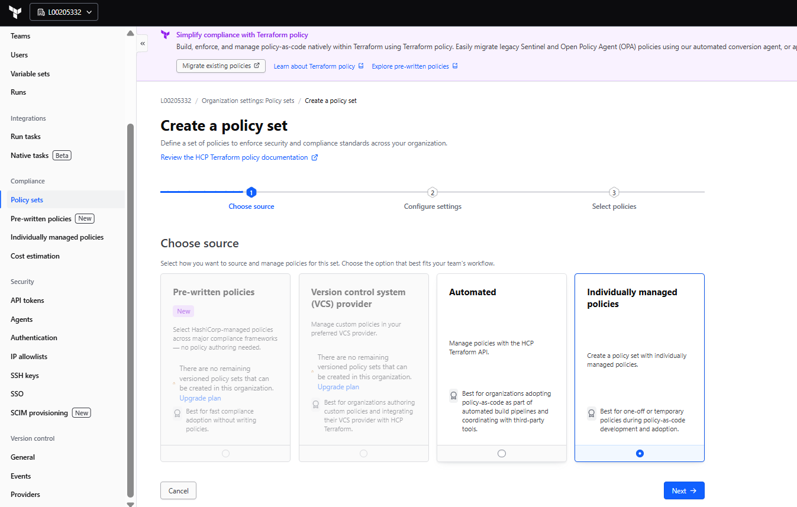</a> |
| **One mandatory policy (API, HTTP 403)** | **One mandatory policy (UI warning)** |
| <a href="documentation/evidence/04-free-tier-1-mandatory-policy-403.png">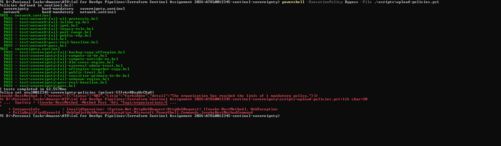</a> | <a href="documentation/evidence/05-guardrails-hard-mandatory-ui-limit.png">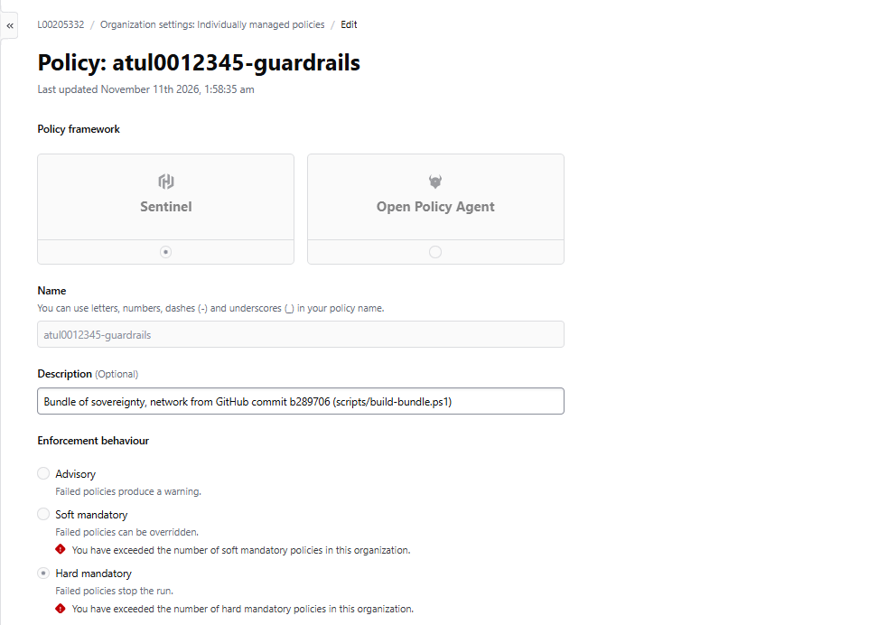</a> |

**Workspace:** VCS-driven from this repo, working directory `terraform`, trigger `/terraform/**/*`, manual apply, speculative plans on PRs.

<a href="documentation/evidence/06-workspace-vcs-settings-1.png">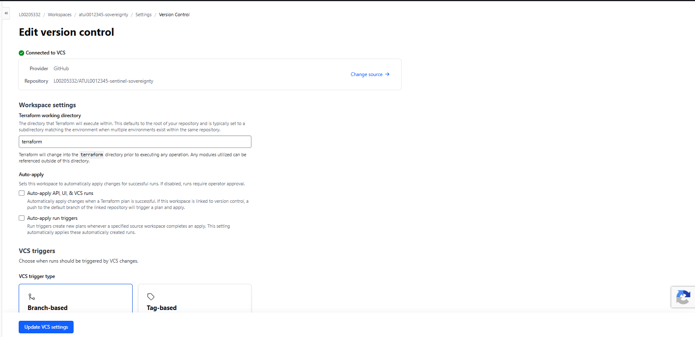</a> <a href="documentation/evidence/07-workspace-vcs-settings-2.png">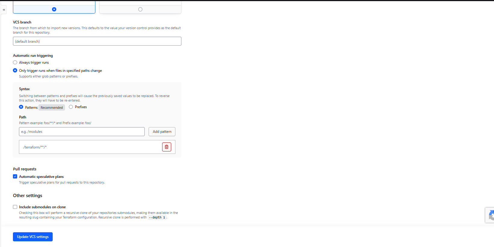</a>

**The policy set as it evolved:** `network` alone → the bundle → the bundle plus the advisory `instance_type` policy. Each policy's description records the GitHub commit it was deployed from.

| `network` only | Bundle | Bundle + advisory | After the float fix (commit `b3c6a12`) |
|---|---|---|---|
| <a href="documentation/evidence/08-policy-set-network-only.png">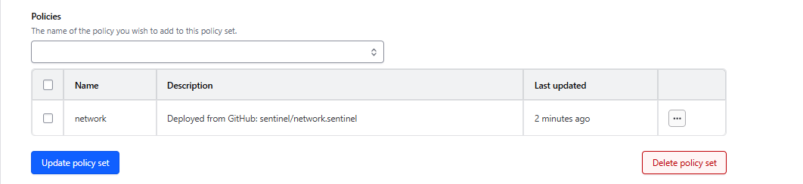</a> | <a href="documentation/evidence/09-policy-set-guardrails-bundle.png">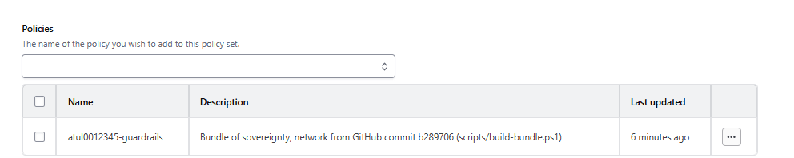</a> | <a href="documentation/evidence/10-policy-set-guardrails-and-instance-type.png">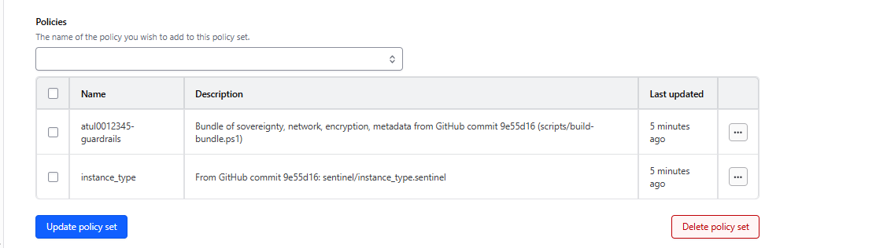</a> | <a href="documentation/evidence/32-policy-set-after-float-fix.png">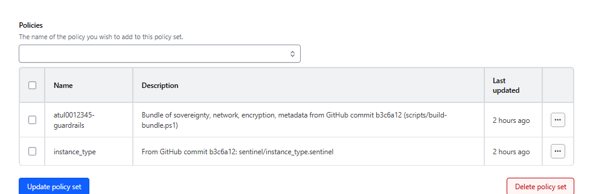</a> |

**Policy deployment** (`scripts/upload-policies.ps1`): tests → bundle build → bundle tests → API upload, tagged with the git commit.

<a href="documentation/evidence/11-upload-policies-bundle-created.png">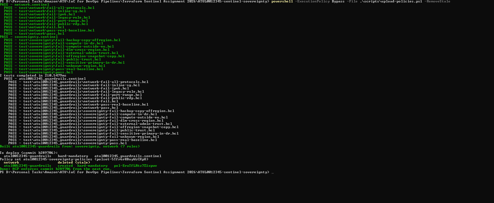</a>

**Cost guard-rail:** a $10/month AWS budget alert was set before any real resource was created.

<a href="documentation/evidence/02-aws-budget-alert.png">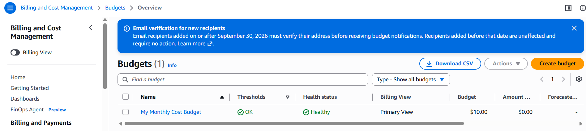</a>

### 6.3 Scenario 1: Compliant baseline (applied)

**Expected:** the plan passes every policy and is applied, and the real resources match the design: Ireland, an encrypted backup copy in Frankfurt, nothing outside the EU.

| Run | Trigger | Plan | Policy check | Outcome |
|---|---|---|---|---|
| `run-Xz7zmhMJKXVNHwa3` "First compliant run: baseline stack with network policy" | UI, commit `74787df` | 23 to add | `network` (hard-mandatory) ✅ passed, on HCP Sentinel 0.40.x | ✅ Applied: 23 created, after manual confirmation |

**Plan:** `region` is known at plan time (AWS provider v6), which the sovereignty policy relies on.

<a href="documentation/evidence/13-compliant-run-plan-region-known.png">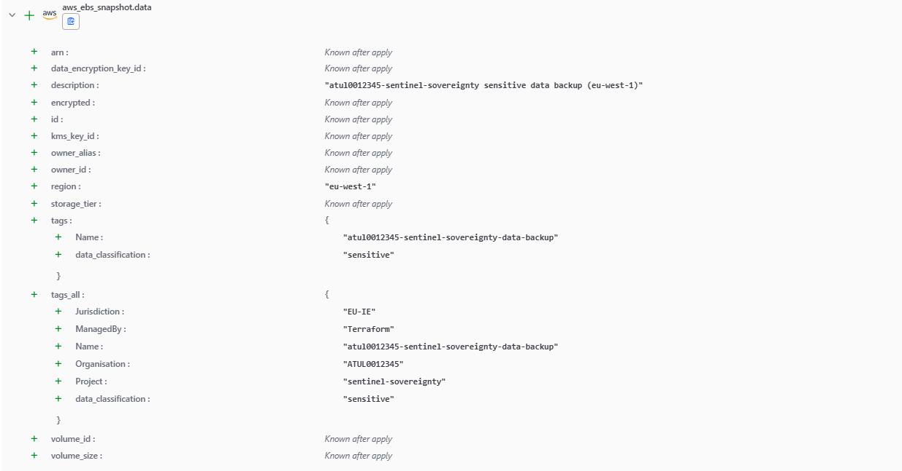</a>

| Plan + policy passed | Applied |
|---|---|
| <a href="documentation/evidence/14-compliant-run-plan-policy-passed.webp">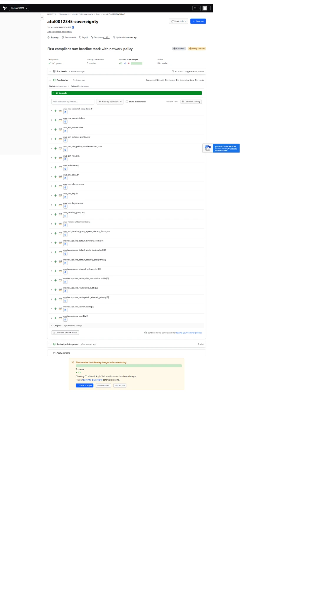</a> | <a href="documentation/evidence/15-compliant-run-applied.webp">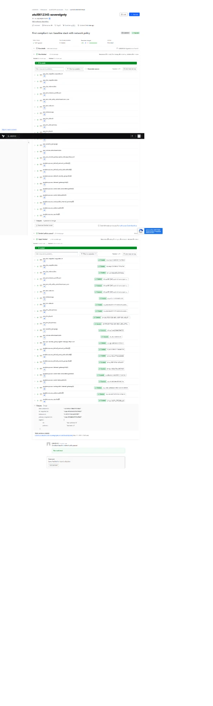</a> |

**Real outcome in AWS** (`scripts/audit-regions.ps1 -AwsProfile atu`):

| When | eu-west-1 | eu-central-1 | us-east-1 (off-region) |
|---|---|---|---|
| Before apply | nothing | nothing | nothing: **CLEAN** |
| After apply | instance (running), root volume 8 GiB encrypted, data volume 1 GiB encrypted, snapshot encrypted, VPC `10.20.0.0/16`, KMS alias | DR snapshot copy encrypted, DR KMS alias | **no drift** |

<a href="documentation/evidence/12-audit-before-apply-clean.png">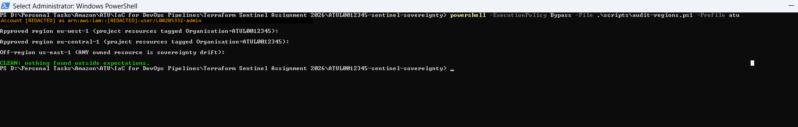</a>

<a href="documentation/evidence/16-audit-after-apply-8-items.png">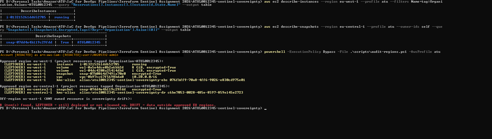</a>

This also confirms that a snapshot's `encrypted` value, unknown at plan time, ends up `True` after apply, because it's inherited from the encrypted volume.

### 6.4 Scenario 2: DR copy outside the EU (PR #9): BLOCKED

**Change:** `dr_region = "us-east-1"`. **Expected:** `atul0012345-guardrails` (hard-mandatory) fails, and the run can't be applied.

| Run | Plan | Policy check | Outcome |
|---|---|---|---|
| Speculative plan for PR #9 | +3 / −3: the DR key, alias and snapshot copy are replaced in `us-east-1` | `atul0012345-guardrails` ❌ **hard failed** | ⛔ Errored; PR check red; closed without merging |

```
Enforcement Mode: hard-mandatory
FAIL resources_in_approved_regions: aws_kms_key.dr is in us-east-1 - approved: ["eu-west-1" "eu-central-1"]
FAIL resources_in_approved_regions: aws_ebs_snapshot_copy.data_dr is in us-east-1 - approved: ["eu-west-1" "eu-central-1"]
FAIL resources_in_approved_regions: aws_kms_alias.dr is in us-east-1 - approved: ["eu-west-1" "eu-central-1"]
FAIL sensitive_data_resident: aws_ebs_snapshot_copy.data_dr holds sensitive data in us-east-1: primary copy must be in eu-west-1, backup copies only in eu-central-1
```

| Plan | Policy hard failed | GitHub check failed |
|---|---|---|
| <a href="documentation/evidence/17-pr9-offregion-plan.png">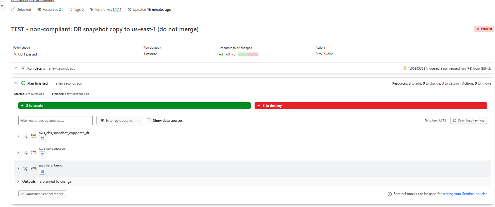</a> | <a href="documentation/evidence/18-pr9-offregion-policy-hard-failed.png">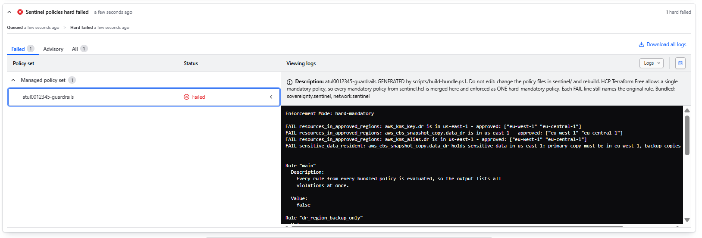</a> | <a href="documentation/evidence/19-pr9-github-checks-failed.png">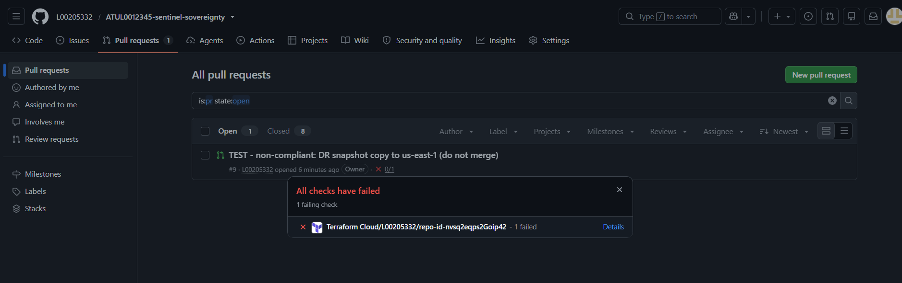</a> |

Observations:
- **All violations in one run**, because `main = all [...]` evaluates every rule instead of stopping at the first failure.
- The **destroy** part of the plan (the compliant Frankfurt copy) didn't cause a violation, because policies ignore deletes by design.
- **Second layer:** the plan succeeded even though the HCP IAM user can't call `us-east-1`, because planning a create makes no create API calls. The IAM region condition would only have blocked it at apply; Sentinel stopped it one stage earlier.
- The real plan from this run is stored (redacted) in `sentinel/mocks/offregion-snapshot/`. `test/sovereignty/fail-real-offregion.hcl` replays it, producing the same four FAIL lines locally.

### 6.5 Scenario 3: Unencrypted EBS volume (PR #12): BLOCKED

**Change:** `aws_ebs_volume.data` `encrypted = false`. **Expected:** `ebs_encrypted` fails.

| Run | Plan | Policy check | Outcome |
|---|---|---|---|
| `run-u9HrW9R8yiofYKmm` for PR #12 | +4 / −4: the volume is replaced, plus its attachment, snapshot and DR copy | 1 of 2 passed: `instance_type` (advisory) ✅, `atul0012345-guardrails` ❌ `FAIL ebs_encrypted: aws_ebs_volume.data is not encrypted` | ⛔ Errored; PR check red; closed without merging |

`ebs_customer_managed_key` stayed **true**, because the key was still set in the code, which shows the two encryption rules are independent.

| Plan | Policy hard failed | GitHub: check failed, merge still enabled |
|---|---|---|
| <a href="documentation/evidence/20-pr12-unencrypted-plan.png">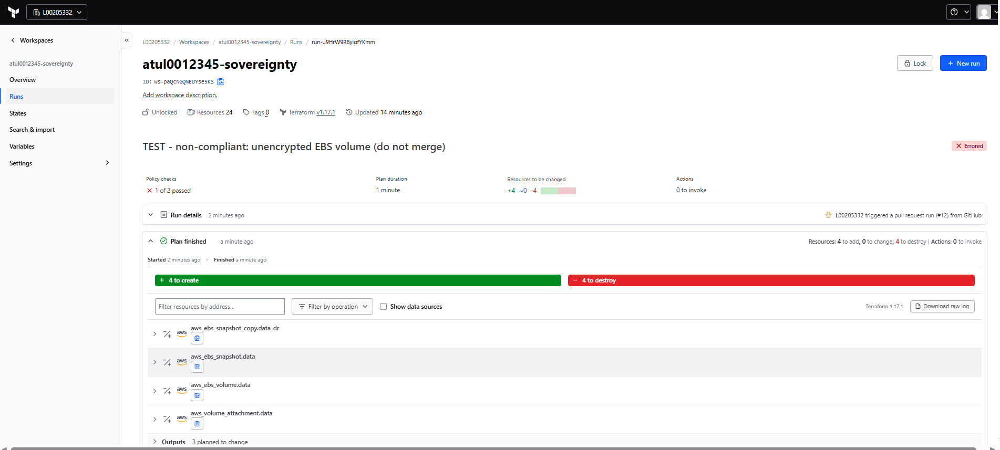</a> | <a href="documentation/evidence/21-pr12-unencrypted-policy-hard-failed.png">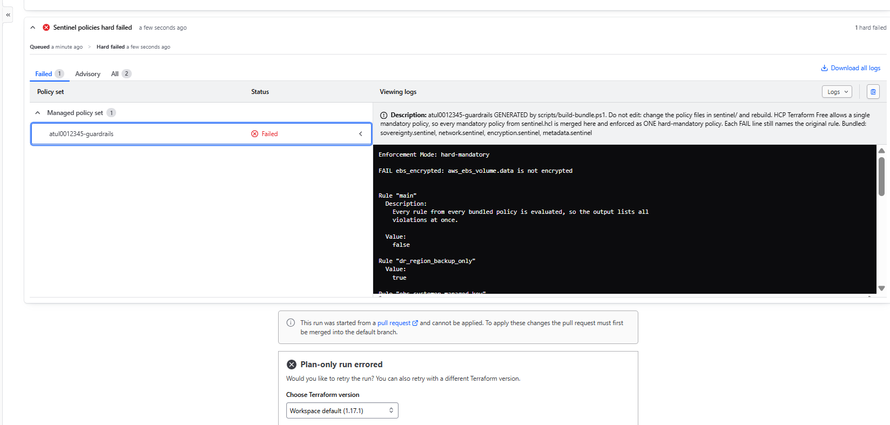</a> | <a href="documentation/evidence/22-pr12-github-checks-failed-merge-enabled.png">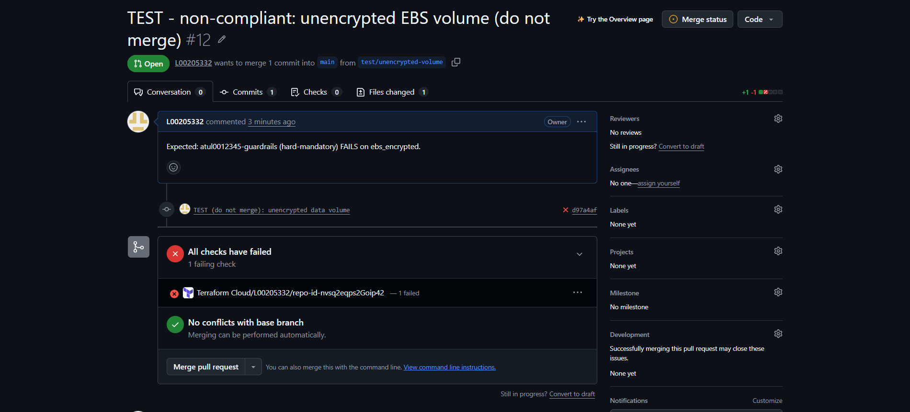</a> |

**Finding: GitHub still offered "Merge pull request" despite the failed check.** Without branch protection, a failed policy check stops the **apply**, but not the **merge**. A merge would put non-compliant code on `main`. The resulting run would fail the hard-mandatory policy again, so nothing would be deployed, but `main` would no longer be compliant. **Fix:** a branch protection rule on `main` that requires the *Terraform Cloud* status check, so GitHub refuses the merge and enforcement moves one step earlier, to code review (see 7.4).

### 6.6 Scenario 4: IMDSv1 allowed (PR #13): BLOCKED, and a policy bug found

**Change:** `http_tokens = "optional"`. **Expected:** `imdsv2_required` fails.

| Run | Plan | Policy check | Outcome |
|---|---|---|---|
| First speculative plan for PR #13 | ~1: `aws_instance.app` updated in place | guardrails ❌ `FAIL imdsv2_required: aws_instance.app allows IMDSv1 (http_tokens = optional)` **plus a false** `FAIL imds_hop_limit_restricted: … hop_limit = 1, maximum allowed is 1` | ⛔ Errored; exposed a policy bug |
| Re-run `run-Am7V2uCBV3XFgcYm` after the fix (PR #14) | ~1 | guardrails ❌ **only** `FAIL imdsv2_required` | ⛔ Errored; blocked for the right reason only |

**The bug:** the hop-limit rule required the value's type to be `int`. HCP passes plan numbers as **floats** (`1.0`), but downloaded mocks store them as ints (`1`). So all 40 local tests passed, while every HCP run (compliant ones included) would have failed this rule.

**Fix (PR #14):**
- The rule now accepts `int` or `float`.
- New float regression tests for the metadata policy (`pass-float-hop`, `fail-float-hop-2`) and the network policy, which compares port numbers (`pass-float-ports`, `fail-float-ports`).
- Reverting the fix makes `pass-float-hop` fail with HCP's exact message.

| Plan | Policy before the fix (false hop-limit line) |
|---|---|
| <a href="documentation/evidence/23-pr13-imdsv1-plan.png">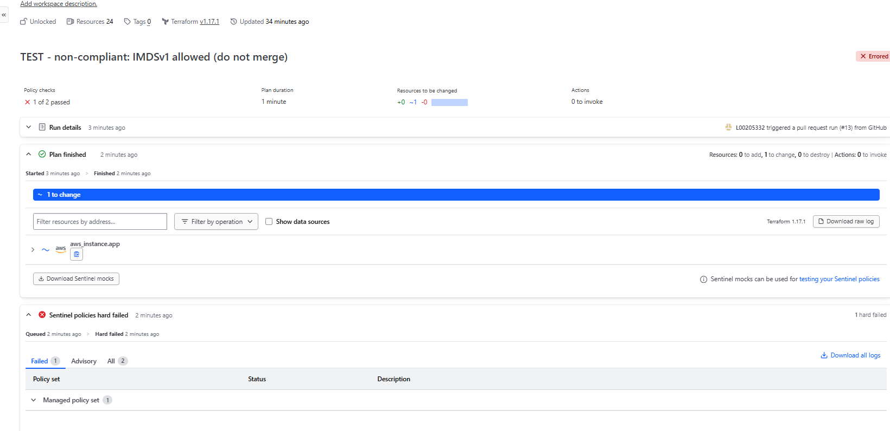</a> | <a href="documentation/evidence/24-pr13-imdsv1-policy-before-fix-false-hop.png">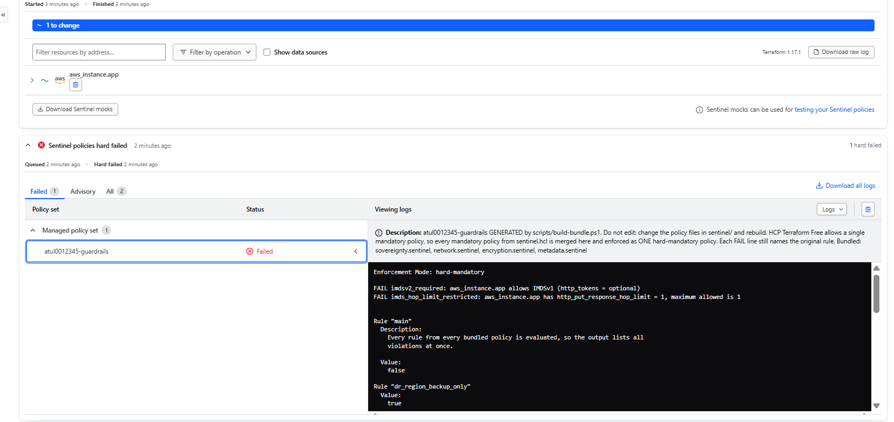</a> |
| **Plan after the fix** | **Policy after the fix (only `imdsv2_required`)** |
| <a href="documentation/evidence/26-pr13-imdsv1-plan-after-fix.png">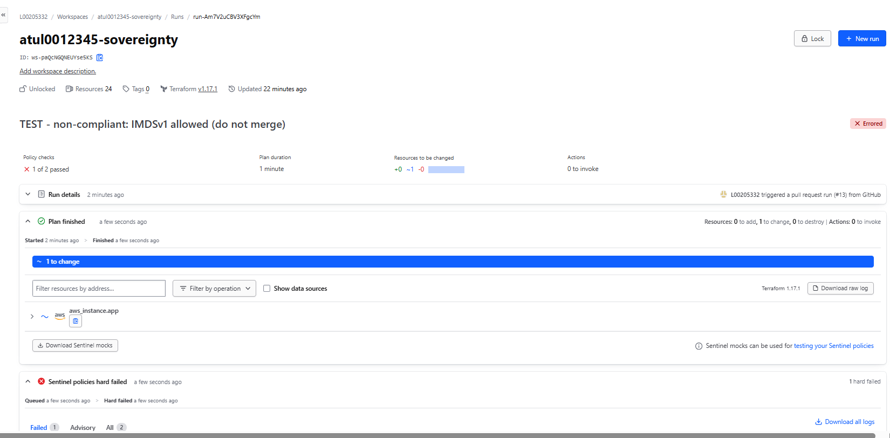</a> | <a href="documentation/evidence/27-pr13-imdsv1-policy-after-fix.png">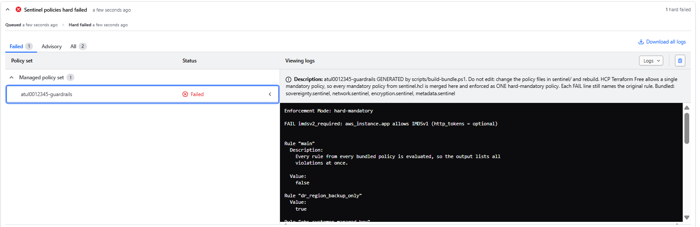</a> |

<a href="documentation/evidence/25-pr13-github-after-fix.png">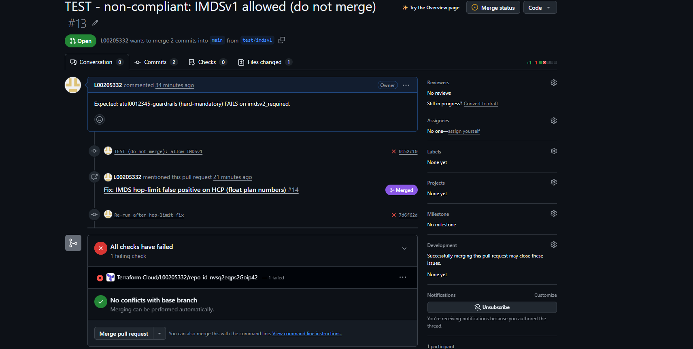</a>

**Lesson:** mock-based tests are only as faithful as the mocks, and mock files lose number types. A live run on the real platform is still needed (see 7.4).

### 6.7 Scenario 5: Advisory, `t3.large`

**Change:** `instance_type = "t3.large"`. **Expected:** `atul0012345-guardrails` passes; `instance_type` (advisory) warns; the run is **not** blocked.

| Run | Plan | Policy check | Outcome |
|---|---|---|---|
| Speculative plan for PR #17 | +5 / −5: the instance is **replaced** (see the finding below) | ⚠️ **"Sentinel policies passed", 1 advisory failed**: guardrails ✅, `instance_type` ⚠️ `WARN instance_types_approved: aws_instance.app uses t3.large` | ✅ **"Planned and finished"**: not blocked; GitHub "All checks have passed"; closed without merging |

```
Enforcement Mode: advisory
WARN instance_types_approved: aws_instance.app uses t3.large - approved: ["t3.micro" "t3.small" "t3a.micro" "t3a.small"]
```

| Policy check: passed with 1 advisory failure | Advisory log |
|---|---|
| <a href="documentation/evidence/28-pr17-t3large-policy-passed-advisory.png">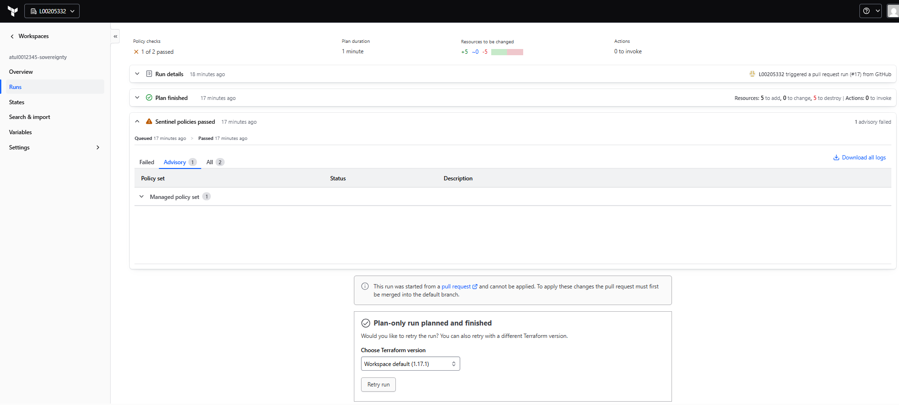</a> | <a href="documentation/evidence/29-pr17-t3large-advisory-warn-log.png">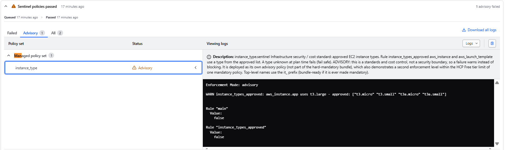</a> |
| **GitHub: all checks passed, merge enabled** | **Plan: +5 / −5** |
| <a href="documentation/evidence/30-pr17-t3large-github-checks-passed.png">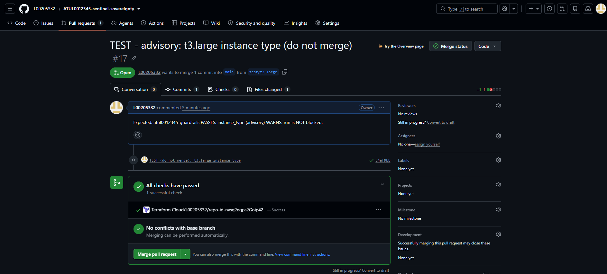</a> | <a href="documentation/evidence/31-pr17-t3large-plan-instance-replaced.png">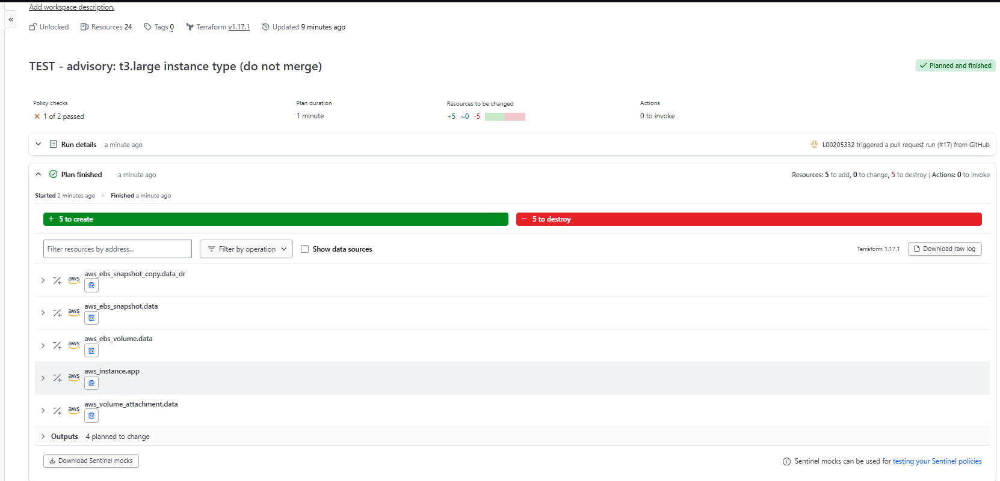</a> |

**Hard-mandatory vs advisory, side by side:**

| | Scenarios 2–4 (hard-mandatory bundle) | Scenario 5 (advisory) |
|---|---|---|
| HCP policy result | ❌ "Sentinel policies **hard failed**" | ⚠️ "Sentinel policies **passed**", 1 advisory failed |
| Run | ⛔ Errored | ✅ Planned and finished |
| GitHub check | ❌ "All checks have failed" | ✅ "All checks have passed" |

**Risk of advisory enforcement:** GitHub shows a **green** check with **no sign of the warning**; a reviewer has to open HCP to see it. Merging would trigger a real run that the advisory policy cannot stop, and a `t3.large` would be deployed. That's acceptable for a cost/standards control, and exactly why security and sovereignty controls are hard-mandatory.

**Finding: an unpinned AMI made every plan replace the instance and the sensitive data volume.** A resize was expected to be an in-place update (`~1`), but the plan was **+5 / −5**: `aws_instance.app ami: … Forces replacement`.
- The AMI comes from AWS's *latest Amazon Linux 2023* SSM parameter, and AWS had published a new image since the stack was deployed. So **any** plan, even with no code change, would now replace the instance.
- The data volume takes its availability zone from the instance, so a new instance makes the AZ unknown and the volume is **replaced** too, which would be **data loss**. The snapshot, DR copy and attachment follow.
- **Supply chain:** "latest" is an **unpinned dependency**, the same problem as an unpinned module: the image that runs changes without any code change or review (see 7.3).
- **Plan-time policy gap:** no policy flagged that a plan **destroys sensitive data** (see 7.4).
- **Remediation (recommended, not applied):** pin the AMI (`lifecycle { ignore_changes = [ami] }`, so AMI updates become a deliberate, reviewed change), and take the volume's AZ from the subnet instead of the instance. A Sentinel rule could also block replacing or deleting `data_classification = sensitive` resources.
- **Decision:** accepted as a known risk for this assignment. The stack holds no real data and is destroyed after testing, so there was no value in the fix here. In production, the remediation above would be required before the next apply. The finding is kept as evidence of a limitation of plan-time policy.

### 6.8 Scenario 6: Drift, manual off-region copy

**Change:** the sensitive backup snapshot (`snap-07b0864d7491a70e0`, eu-west-1) is copied to **`us-east-1` by hand** with the AWS CLI, using the admin identity, outside Terraform. This simulates a mistake or an insider. **Expected:** Terraform and Sentinel don't see it; the out-of-band audit does.

```
aws ec2 copy-snapshot --region us-east-1 --source-region eu-west-1 --source-snapshot-id snap-07b0864d7491a70e0 --encrypted --description "DRIFT TEST: manual copy outside Terraform"
→ snap-0dec8f104a1958d6f   us-east-1   completed   encrypted
```

| Control | Sees the off-region copy? | Evidence |
|---|---|---|
| AWS / IAM for the **human admin** | ❌ allowed: only the HCP pipeline user is region-restricted | the copy completed |
| **Terraform** (refresh-only run) | ❌ **+0 ~0 −0**: the copy isn't in the state | screenshot 33 |
| **Sentinel** (same run) | ❌ **2 of 2 passed**: `atul0012345-guardrails` and `instance_type` both passed, because the plan is empty | screenshot 33 |
| **`scripts/audit-regions.ps1`** (reads the real account) | ✅ **`[DRIFT] us-east-1 snapshot snap-0dec8f104a1958d6f`**, even though the copy carries **no project tags** | screenshot 34 |

**Remediation:** `aws ec2 delete-snapshot --region us-east-1 --snapshot-id snap-0dec8f104a1958d6f`. The audit then shows `us-east-1` empty and the 8 expected project items (screenshot 35).

| HCP: refresh-only, no changes, policies passed | Audit: DRIFT detected | Audit: after remediation |
|---|---|---|
| <a href="documentation/evidence/33-drift-refresh-only-no-changes-policies-passed.png">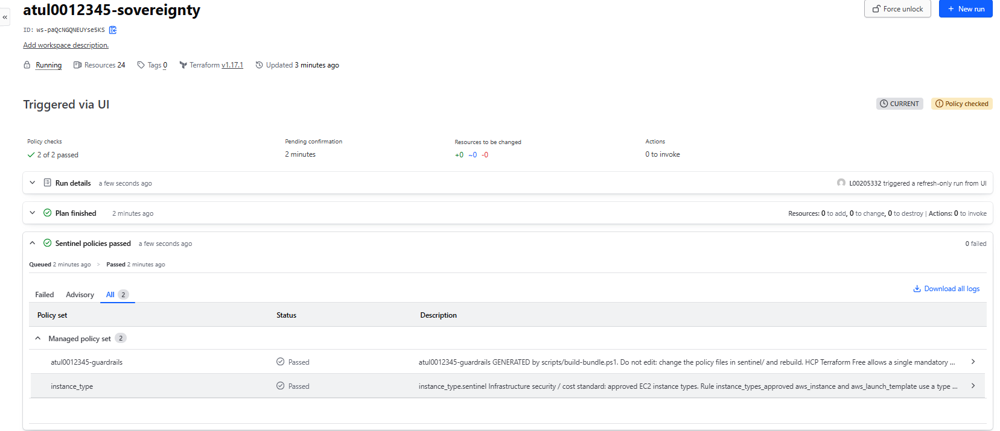</a> | <a href="documentation/evidence/34-drift-audit-detects-us-east-1-copy.png">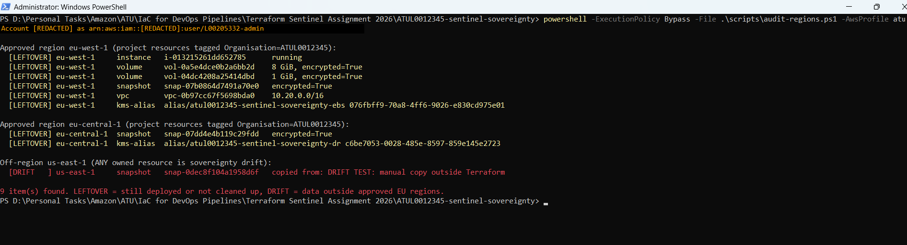</a> | <a href="documentation/evidence/35-drift-audit-after-remediation.png">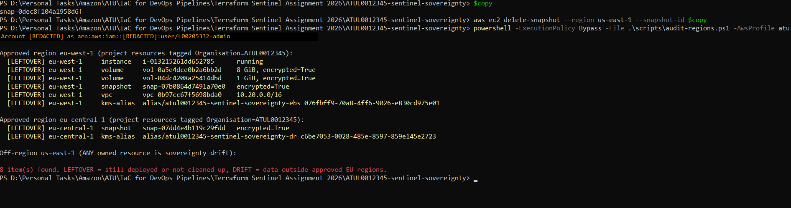</a> |

What this shows:
- **Plan-time policy only governs changes made *through* Terraform.** Data moved by any other path (console, CLI, scripts, AWS Backup jobs set up by hand) is invisible to it, and the policy check even reports *passed*.
- **The jurisdiction and the keys are lost together.** The copy left the EU and is encrypted with AWS's default key in `us-east-1`, not the organisation's customer-managed key, which stays in Ireland. Customer-managed key control, a sovereignty measure, doesn't follow data copied out of band.
- **The IAM region restriction protects only the pipeline identity.** People with broader permissions can still move data. Closing that gap needs an organisation-level guardrail, e.g. an **AWS Organizations SCP** that denies all non-EU regions for every identity, plus continuous detection (AWS Config rules, CloudTrail alerts on `CopySnapshot`) instead of a manually run audit.
- **Detection tags must not be trusted.** The copy carried no project tags, so the audit treats **any** resource in an off-region as drift, instead of filtering by tag as it does in the EU regions.

### 6.9 Scenario 7: Unpinned module (PR #21): BLOCKED

**Change:** `module "vpc"` `version = "6.0.0"` → `"~> 6.0"`. **Expected:** `modules_pinned` fails. This is the most realistic supply-chain mistake: a range looks harmless, but **modules aren't recorded in `.terraform.lock.hcl`**, so every `terraform init` may fetch newer module code that nobody reviewed.

Policies were first redeployed with the supply chain policy in the bundle (5 policies, 16 rules, commit `a873e1a`):

<a href="documentation/evidence/36-upload-bundle-with-supply-chain.png">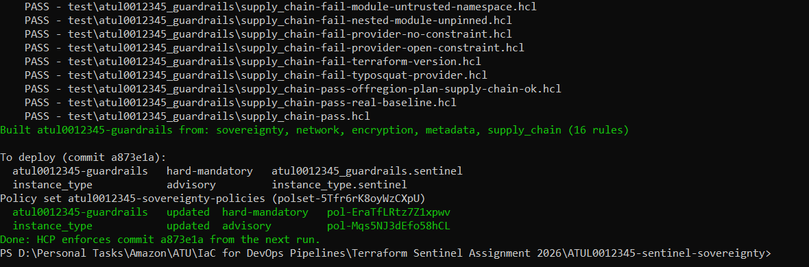</a>

| Run | Plan | Policy check | Outcome |
|---|---|---|---|
| Speculative plan for PR #21 (commit `4acd1e4`) | +5 / −5 (the unrelated AMI replacement from scenario 5) | `atul0012345-guardrails` ❌ **hard failed**: `FAIL modules_pinned: module "vpc" (terraform-aws-modules/vpc/aws) is not pinned to an exact version: "~> 6.0"` | ⛔ Errored; PR check red; closed without merging |

**Plan versus policy:** the HCP status page shows the two checks separately. The **Terraform plan succeeded** ✅ (*5 to add, 0 to change, 5 to destroy*), while the **Sentinel check failed** ❌ (*Policy checks failed (hard-mandatory)*). The change was technically deployable; only the policy said it wasn't allowed. Every other rule, sovereignty, encryption, IMDSv2 and the provider rules included, passed, so the failure isolates the module pin.

| Policy hard failed | HCP status: plan ✅, policy ❌ | GitHub check failed |
|---|---|---|
| <a href="documentation/evidence/37-pr21-unpinned-module-policy-hard-failed.png">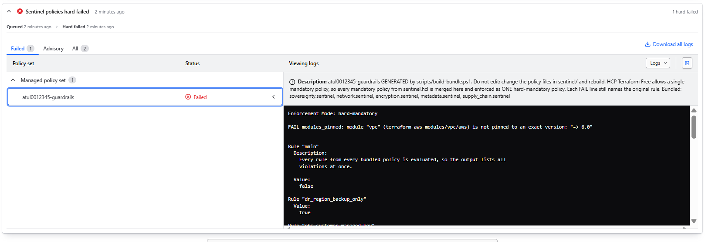</a> | <a href="documentation/evidence/38-pr21-hcp-status-plan-ok-policy-failed.png">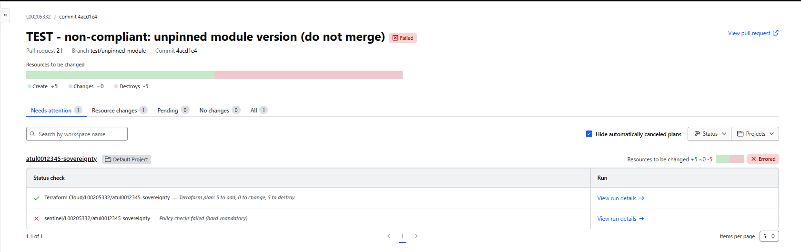</a> | <a href="documentation/evidence/39-pr21-github-checks-failed.png">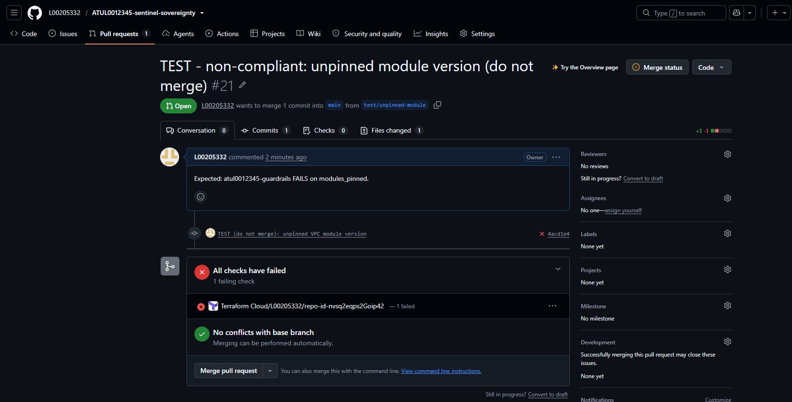</a> |

### 6.10 Local mock tests (`sentinel test`)

Run with `cd sentinel; sentinel test`. A test case passes when the policy returns the result the test expects, so a `fail-*.hcl` test **passing** means the policy correctly **rejected** that mock. Tests named `pass-real-*` / `fail-real-*` replay **real** plans downloaded from HCP runs.

| Policy | Test case | Scenario | Expected `main` | Result |
|---|---|---|---|---|
| network | `pass.hcl` | SSH from the VPC only, public HTTPS (v4+v6), inline SG internal-only, legacy egress-all, deleted open SSH rule | true | ✅ PASS |
| network | `pass-real-baseline.hcl` | **Real plan** from HCP run `run-Xz7zmhMJKXVNHwa3` (23 resources) | true | ✅ PASS |
| network | `pass-float-ports.hcl` | Public HTTPS with ports `443.0` (float, as HCP passes it) | true | ✅ PASS |
| network | `fail.hcl` | SSH from `0.0.0.0/0` | false | ✅ PASS |
| network | `fail-ipv6.hcl` | SSH from `::/0` | false | ✅ PASS |
| network | `fail-port-range.hcl` | TCP 0–65535 from the internet | false | ✅ PASS |
| network | `fail-all-protocols.hcl` | `ip_protocol = "-1"` from the internet | false | ✅ PASS |
| network | `fail-public-rdp.hcl` | RDP 3389 from the internet (SSH rule passes, ingress rule fails) | false | ✅ PASS |
| network | `fail-inline-sg.hcl` | SSH via inline `aws_security_group` ingress | false | ✅ PASS |
| network | `fail-legacy-rule.hcl` | SSH on IPv6 via legacy `aws_security_group_rule` | false | ✅ PASS |
| network | `fail-float-ports.hcl` | SSH `22.0` and range `0.0–65535.0` from the internet (floats) | false | ✅ PASS |
| sovereignty | `pass.hcl` | Irish compute + sensitive volume, Frankfurt snapshot copy + key, EC2-trusted IAM role, `random_id`, a data source in us-east-1, deletion of a us-east-1 copy, DLM and Backup copies to Frankfurt, a vault ARN unknown at plan time | true | ✅ PASS |
| sovereignty | `pass-real-baseline.hcl` | **Real plan** (23 resources): all 5 rules true | true | ✅ PASS |
| sovereignty | `fail-offregion-snapshot-copy.hcl` | Sensitive snapshot copy + key in **us-east-1** | false (regions ❌, sensitive ❌) | ✅ PASS |
| sovereignty | `fail-real-offregion.hcl` | **Real plan** of the blocked PR #9; produces the same 4 FAIL lines as HCP | false (regions ❌, sensitive ❌, others ✅) | ✅ PASS |
| sovereignty | `fail-compute-outside-eu.hcl` | EC2 in us-east-1 | false (regions ❌) | ✅ PASS |
| sovereignty | `fail-compute-in-dr.hcl` | EC2 in Frankfurt: in the EU, but the DR region is backups only | false (regions ✅, DR ❌) | ✅ PASS |
| sovereignty | `fail-sensitive-primary-in-dr.hcl` | Primary sensitive volume in Frankfurt | false (DR ❌, sensitive ❌) | ✅ PASS |
| sovereignty | `fail-dlm-cross-region.hcl` | DLM policy in Ireland copying snapshots to us-east-1 | false (replication ❌) | ✅ PASS |
| sovereignty | `fail-backup-copy-offregion.hcl` | AWS Backup copy to a us-east-1 vault | false (replication ❌) | ✅ PASS |
| sovereignty | `fail-unknown-region.hcl` | Region unknown until apply (fail safe) | false (regions ❌) | ✅ PASS |
| sovereignty | `fail-external-admin-trust.hcl` | IAM role trusts another AWS account | false (trust ❌) | ✅ PASS |
| sovereignty | `fail-public-trust.hcl` | IAM role trusts `"*"` | false (trust ❌) | ✅ PASS |
| encryption | `pass.hcl` | CMK volume, instance root, DR copy with a constant CMK ARN, launch template disk, deletion of an old unencrypted volume | true | ✅ PASS |
| encryption | `pass-real-baseline.hcl` | **Real plan + config**: volume, root disk and DR copy all encrypted with CMK references | true | ✅ PASS |
| encryption | `fail-unencrypted-volume.hcl` | `encrypted = false`, no key | false (encrypted ❌, CMK ❌) | ✅ PASS |
| encryption | `fail-aws-managed-key.hcl` | Encrypted with `alias/aws/ebs` | false (encrypted ✅, CMK ❌) | ✅ PASS |
| encryption | `fail-default-key.hcl` | Encrypted, no `kms_key_id` (AWS default key) | false (CMK ❌) | ✅ PASS |
| encryption | `fail-unencrypted-root.hcl` | Instance root disk not encrypted | false | ✅ PASS |
| encryption | `fail-root-not-configured.hcl` | No `root_block_device` (fail safe) | false | ✅ PASS |
| encryption | `fail-unencrypted-copy.hcl` | DR snapshot copy not encrypted | false | ✅ PASS |
| encryption | `fail-launch-template-unencrypted.hcl` | Launch template disk `encrypted = "false"` | false | ✅ PASS |
| metadata | `pass.hcl` | IMDSv2 instance + launch template; instance with IMDS disabled | true | ✅ PASS |
| metadata | `pass-real-baseline.hcl` | **Real plan**: `http_tokens = required`, hop limit 1 | true | ✅ PASS |
| metadata | `pass-float-hop.hcl` | Hop limit `1.0` (float). Regression test for the PR #13 bug | true | ✅ PASS |
| metadata | `fail-imdsv1-optional.hcl` | `http_tokens = "optional"` | false (IMDSv2 ❌, hop ✅) | ✅ PASS |
| metadata | `fail-no-metadata-options.hcl` | No `metadata_options` (fail safe) | false | ✅ PASS |
| metadata | `fail-hop-limit-2.hcl` | IMDSv2 but hop limit 2 | false (IMDSv2 ✅, hop ❌) | ✅ PASS |
| metadata | `fail-float-hop-2.hcl` | Hop limit `2.0` (float) | false (hop ❌) | ✅ PASS |
| metadata | `fail-launch-template-imdsv1.hcl` | Launch template allows IMDSv1 | false | ✅ PASS |
| supply_chain | `pass.hcl` | `hashicorp/aws ~> 6.0`; registry modules pinned to `6.0.0` and `= 5.1.2`; a local module without a version; a data source; Terraform 1.17.1 | true | ✅ PASS |
| supply_chain | `pass-real-baseline.hcl` | **Real plan + config**: `hashicorp/aws ~> 6.0`, `terraform-aws-modules/vpc/aws 6.0.0`, Terraform 1.17.1 | true | ✅ PASS |
| supply_chain | `pass-offregion-plan-supply-chain-ok.hcl` | **Real** PR #9 plan: it breaks sovereignty, but its providers, modules and version are approved | true | ✅ PASS |
| supply_chain | `fail-typosquat-provider.hcl` | Look-alike provider source `hashicorp-aws/aws` | false (sources ❌) | ✅ PASS |
| supply_chain | `fail-implicit-provider.hcl` | `random_id` uses `hashicorp/random` with no provider block (visible only in the plan) | false (sources ❌) | ✅ PASS |
| supply_chain | `fail-provider-no-constraint.hcl` | `hashicorp/aws` with no version constraint | false (versions ❌) | ✅ PASS |
| supply_chain | `fail-provider-open-constraint.hcl` | `hashicorp/aws >= 5.0` (any future major) | false (versions ❌) | ✅ PASS |
| supply_chain | `fail-module-git-source.hcl` | Module from `git::https://github.com/…` | false (module source ❌) | ✅ PASS |
| supply_chain | `fail-module-untrusted-namespace.hcl` | Registry module from an unapproved namespace | false (module source ❌) | ✅ PASS |
| supply_chain | `fail-module-range.hcl` | Trusted module with `~> 6.0` | false (pinned ❌) | ✅ PASS |
| supply_chain | `fail-module-no-version.hcl` | Trusted module with no version | false (pinned ❌) | ✅ PASS |
| supply_chain | `fail-nested-module-unpinned.hcl` | A module **nested inside** the VPC module uses `>= 1.0` | false (pinned ❌) | ✅ PASS |
| supply_chain | `fail-terraform-version.hcl` | Plan produced by Terraform 1.5.7 | false (version ❌) | ✅ PASS |
| instance_type | `pass.hcl` | `t3.micro` instance, `t3.small` template, template without a type | true | ✅ PASS |
| instance_type | `pass-real-baseline.hcl` | **Real plan**: `t3.micro` | true | ✅ PASS |
| instance_type | `fail-t3-large.hcl` | `t3.large` (advisory) | false | ✅ PASS |
| instance_type | `fail-unknown-type.hcl` | Type unknown at plan time (fail safe) | false | ✅ PASS |

**Bundle tests:** `scripts/build-bundle.ps1` regenerates every mandatory policy's tests against the merged `atul0012345-guardrails` policy:
- Fail cases must be rejected for the same rules.
- Synthetic pass cases must keep that policy's rules true.
- `pass-real*` cases must pass the **whole** bundle.

Result: **53/53 PASS** (5 bundled policies, 16 rules).

**Mutation tests** (does the test suite catch a weakened policy?):

| Mutation | Tests that failed |
|---|---|
| `us-east-1` added to `approved_regions` | 4 sovereignty tests |
| IMDSv1 accepted (`http_tokens` check disabled) | 2 metadata tests |
| AWS-managed keys accepted | 1 encryption test |
| Hop-limit check reverted to `int` only | `pass-float-hop`, with HCP's exact message |
| Any version string accepted as an exact module pin | 2 supply_chain tests (range, nested range) |
| Providers checked only in the config, not in the plan | `fail-implicit-provider` |

A weakened policy can't pass `sentinel test`, and `upload-policies.ps1` refuses to deploy one.

### 6.11 What the real mocks showed

- **`region` is known at plan time for every regional resource**, including ones that never set it (AWS provider v6 fills in the provider's region). Only the three IAM resources have no `region` (a global service). → The sovereignty policy reads `change.after.region` directly.
- **A snapshot's `encrypted` is unknown at plan time** (it's inherited from the volume). → The encryption policy checks the source volume, and the DR copy's own `encrypted`/`kms_key_id`.
- **`kms_key_id` is unknown in the plan** both when it references a new key and when it isn't set at all. → Key checks read `tfconfig/v2`.
- **`tfconfig/v2` lists only the provider blocks and module calls in our code** (`hashicorp/aws ~> 6.0`, `terraform-aws-modules/vpc/aws 6.0.0`). The VPC module's internal `>= 5.79.0` provider requirement is invisible to Sentinel; only `.terraform.lock.hcl` records it.
- **Numbers are floats on HCP but ints in mock files** (see scenario 4).
- **Mock hygiene:** before committing, the mocks were scanned for credentials, the AWS account ID and emails. HCP records sensitive variables only as `"sensitive": true`, never their values.
  - The **baseline** mocks, taken before anything was deployed, contained no account ID.
  - The **PR #9** mocks were taken while the stack was running. Their plan and state held the real **AWS account ID** (330 occurrences) and the instance's **public IP/DNS**, which were replaced with AWS documentation values (`111122223333`, `203.0.113.10`) before committing. No policy reads them, and the real-plan test gives the same result after redaction.
  - Lesson: **mocks from runs against existing infrastructure are effectively a copy of the state**, and must be treated as sensitive data before publishing.

## 7. Decision justification

The arguments below are based on what was actually observed in this project: seven live scenarios (§6.3–6.9), 57 unit tests, mutation tests, and three platform limits found the hard way.

### 7.1 Effectiveness of Policy-as-Code for digital sovereignty

**Assessment: highly effective for changes that go through the pipeline; no protection outside it.**

What worked:
- **Prevention, not detection.** Every non-compliant change in this project was stopped *before* anything was created: a backup copy to `us-east-1` (PR #9), an unencrypted volume (PR #12), IMDSv1 (PR #13) and an unpinned module (PR #21). Each was rejected at plan time, the run ended *Errored*, and no AWS API call was made. Compared with a periodic audit or a manual review, the window of non-compliance is **zero**.
- **The rules are explicit, versioned and testable.** "Ireland for primary data, Frankfurt for encrypted backups only, nothing outside the EU" is written once in `sovereignty.sentinel`, reviewed in a PR and tested by 12 cases, two of them real plans. An auditor can read the rule and see when it changed. A wiki page or a checklist can't offer that.
- **Consistent and fast.** The same policy evaluates every run in about a second, and the message is precise: `FAIL resources_in_approved_regions: aws_ebs_snapshot_copy.data_dr is in us-east-1`. The developer learns *what* and *where* in the PR itself.
- **It covers what region lists alone miss.** Sovereignty isn't only "which region". The policy also restricts what the DR region may hold (backups only), keeps sensitive data's primary copy in Ireland, checks replication targets (DLM, AWS Backup) and blocks foreign accounts from assuming roles (administrative access).

Where it falls short:
- **It governs Terraform, not the account.** The manual `us-east-1` copy (scenario 6) passed every policy (*2 of 2 passed*), because it never appeared in a plan. Only the out-of-band audit caught it.
- **A policy is only as good as its enforcement level and the platform limits.** On HCP Free only one mandatory policy is allowed, so the controls had to be bundled (§4.4). An advisory policy shows a **green** GitHub check (scenario 5), which a reviewer can easily misread as "compliant".

**Conclusion:** Policy-as-Code is the right *first* layer: cheap, preventive and auditable. Sovereignty needs **defence in depth** around it: the IAM region restriction on the pipeline (already in place), an organisation-level guardrail for every identity (an AWS Organizations **SCP** denying non-EU regions), and continuous detection (AWS Config / CloudTrail alerts instead of a manually run audit).

### 7.2 Limitations of region-based data residency controls

A region code is a proxy for jurisdiction, and the proxy leaks in several places:

1. **Region is not jurisdiction.** `eu-west-1` keeps the data *physically* in Ireland, but the operator is a US-headquartered provider. Under the US CLOUD Act, US authorities can compel such providers to disclose data regardless of where it's stored. A region rule can't express "free from foreign legal reach". That needs contractual, organisational or technical measures such as customer-held keys, or a sovereign/EU-operated cloud.
2. **Only what Terraform deploys is checked.** Copies made by hand, by scripts or by services configured outside Terraform aren't seen (scenario 6). **Key control is lost along with residency:** the manual copy was encrypted with AWS's default key in `us-east-1`, not the organisation's Irish customer-managed key.
3. **Global services have no region.** IAM, Route 53 and CloudFront can only be **exempted** (`param global_type_prefixes`), not constrained. CloudFront caches content at edge locations worldwide.
4. **Some data flows don't carry a region at all.** An S3 replication destination is a bucket ARN (`arn:aws:s3:::bucket`) with no region, so the plan alone can't prove where the data goes. Logs, metrics, support cases and provider telemetry can also leave the region without any resource being declared.
5. **Classification depends on tagging.** `sensitive_data_resident` protects data tagged `data_classification = sensitive`. Untagged sensitive data is only covered by the general region rule, and a tag is only as reliable as the people and processes that apply it.
6. **Unknown values.** If a region were only known after apply, the policy can't prove residency. It fails safe (`fail-unknown-region`), which is correct but can block legitimate designs.

**What would strengthen it:** an SCP region guardrail for all identities; customer-managed keys whose policies only allow principals in the organisation; mandatory classification tags enforced by policy; continuous detection of off-region resources; and, where the legal reach of the operator matters, contractual sovereignty controls or an EU-operated provider.

### 7.3 Importance of supply chain integrity

Infrastructure code is executed with **high privileges**: the HCP IAM user can create networks, instances, keys and roles. Whoever controls the code that Terraform runs controls the account. The supply chain is therefore part of the security perimeter. A sovereignty policy is worthless if a compromised provider or module can exfiltrate data or rewrite resources.

This project addressed it in **layers that cover each other's gaps:**

| Layer | Protects | Evidence |
|---|---|---|
| `.terraform.lock.hcl` + HashiCorp GPG signature | the provider **bytes**: exact version `6.72.0` and SHA-256 checksums for Linux (HCP, CI) and Windows | `init` reports "signed by HashiCorp"; CI re-verifies on every PR |
| `supply_chain.sentinel` | the **intent**: which sources, constraints and module versions may appear in code at all, so loosening them in a PR is blocked | PR #21 blocked on `modules_pinned`; 13 tests, 2 mutations caught |
| Pinned CI | the pipeline itself: actions pinned to commit SHAs, the Sentinel binary checked against a hard-coded SHA-256 | `sentinel.zip: OK` in the CI log |
| Least-privilege, region-restricted pipeline identity | the **blast radius** if anything upstream is compromised | `iam/hcp-terraform-policy.json` |

Lessons from the project:
- **Modules are the weak point.** They aren't recorded in the lock file, so a range such as `~> 6.0` silently pulls new code on the next `init`. An exact pin in the code, enforced by `modules_pinned`, is the only control. A trusted namespace still doesn't guarantee trusted content.
- **Dependencies hide in places we don't call dependencies.** The AMI taken from AWS's *"latest Amazon Linux 2023"* parameter changed without any code change, and turned a harmless resize into a plan that **replaces the sensitive data volume** (scenario 5). Pinning applies to images as much as to providers and modules.
- **Sentinel can't verify everything** (§4.2 table): binary integrity, a module's internal requirements (the VPC module's own `>= 5.79.0` is invisible in `tfconfig/v2`), a compromised maintainer or registry, or a compromise of the repository, CI or HCP itself. Those need checksums, code review of module versions, branch protection and least-privilege tokens.

### 7.4 Limitations of Sentinel and plan-time enforcement

Plan-time enforcement has a fundamental boundary: **it judges a proposed change, not the real world.** Within that boundary, this project found concrete limits:

1. **No visibility outside Terraform (drift).** The manual off-region copy passed every policy, and a refresh-only run showed `+0 ~0 −0` (scenario 6).
2. **Unknown-until-apply values.** A snapshot's `encrypted` and any `kms_key_id` referencing a key created in the same run are *unknown* in the plan, so the key check had to read `tfconfig/v2` instead. Writing correct policies needs detailed knowledge of each resource type's plan representation.
3. **Attributes, not consequences.** No policy flagged that PR #17's plan would **destroy and recreate the sensitive data volume**. The policies check *what* a resource looks like, not *what happens to existing data*. That needs a dedicated rule on `change.actions` (e.g. block `delete` of `data_classification = sensitive` resources).
4. **Mocks are not the platform.** Downloaded mocks store plan numbers as ints, but HCP evaluates them as floats. A type check that passed 40 local tests failed **every** HCP run, compliant ones included (PR #13). Without the live test, this would have blocked the next legitimate deployment. Unit tests are necessary but not sufficient.
5. **The policy gates the run, not the merge.** GitHub still offered "Merge pull request" on a red check (PR #12), so non-compliant code could still reach `main`. Branch protection that requires the HCP and CI checks is needed to make the PR gate binding.
6. **Advisory results are easy to miss.** An advisory failure leaves the GitHub check **green** (scenario 5).
7. **Visibility into modules is limited.** `tfconfig/v2` shows our module calls, not the module's own requirements.
8. **Destroys must not be blocked.** Policies also run on destroy plans, so they deliberately ignore deletions. Otherwise removing a non-compliant resource would be impossible. That same choice is why limitation 3 exists.
9. **Language pitfalls.** `and` short-circuits, so only the first failing rule was reported until `main = all [...]` was used; `rule` is a reserved word; `strings.contains` doesn't exist. Each was found by tests, which shows policies need the same engineering discipline as application code.

### 7.5 Maintaining policies as cloud environments evolve

Policies encode assumptions about providers, platforms and the organisation, and all three change:

- **Providers change the plan.** AWS provider v6 added a per-resource `region` argument. That made the sovereignty policy simpler, since `change.after.region` is populated for every regional resource, but a policy written for v5 would have missed resources created this way. New resource types (e.g. a new replication service) create new paths that no rule covers yet. **Every provider major upgrade needs a policy review.** `provider_versions_approved` forces that upgrade through a deliberate change, and the real-plan tests make it testable.
- **Platforms change the design.** HCP Free allowed one policy set, **no** versioned policy sets and **one** mandatory policy. Each limit appeared only as an HTTP 403 and forced a redesign: API deployment, then bundling, then a single enforcement level. A move to a paid tier would let the same `sentinel.hcl` deploy each policy separately with its own level.
- **Policy deployment can drift from the code.** With no VCS-linked policy sets, HCP enforces whatever was last uploaded. Mitigations: the git commit recorded in each policy's description, and the CI `deploy-policies` job on `main`.
- **Tests must evolve with the policies.** Hand-written mocks capture what we *expect* plans to look like. Real mocks capture what they *are*. Refreshing real mocks after provider or Terraform upgrades, and keeping mutation tests, keeps the suite honest (the float bug in PR #13 is the example).
- **The organisation changes too.** New regions may be approved (e.g. a second EU DR region), new data classifications introduced, or exceptions granted. Keeping those values in **parameters** (`approved_regions`, `sc_approved_providers`, `it_approved_types`) makes such changes small, reviewable PRs instead of rewrites.

**Recommendation:** treat policies as a product. Give them an owner and versioned releases with real-plan regression tests, review them on every provider, Terraform or platform change, and add continuous detection for everything plan-time policy can't see.

### Technical report

The one-page technical report condenses this section into **limitations found** and **recommendations**: [`documentation/technical-report/technical-report.pdf`](documentation/technical-report/technical-report.pdf) (source: [`technical-report.md`](documentation/technical-report/technical-report.md)). After editing the Markdown, rebuild the PDF and check it still fits one A4 page with:

```bash
powershell -ExecutionPolicy Bypass -File .\documentation	echnical-reportuild-report.ps1
```

## 8. Declaration of AI tool usage

As the brief requires, any use of LLM tools is declared here.

| Item | Detail |
|------|--------|
| Tool | Claude Code (Anthropic), desktop app |
| Model | Claude Opus 5.5 (`claude-opus-5-5`) |
| Used for | Reviewing the brief, explaining Terraform/Sentinel concepts, writing the code (Sentinel policies, mocks, tests, Terraform, scripts, CI), assembling the evidence, drafting §7 and the technical report from the project's findings, and keeping this README up to date |
| Prompts | **Every prompt, verbatim, in [`prompts.md`](prompts.md)**, each with a note on what the AI did |

**My own contribution:** I made the design decisions (region model with Frankfurt as EU DR and `us-east-1` as the denied test region, real AWS resources with a cleanup script per stack, static HCP credentials as an accepted trade-off, PR-based testing), walked through the assignment step by step, read and reviewed all generated code, ran the tests, and performed all git operations, PRs and merges myself.

Further decisions and work of my own:
- **Chose how to work around each HCP Free limit:** API-deployed policies, and **bundling** all mandatory policies into one so that every control still blocks, rather than downgrading them to advisory.
- **Designed and ran every live test myself:** seven scenarios via PRs and the AWS CLI. I **spotted the evidence gaps**: missing screenshots in the README, the first-run hop-limit result, the AMI replacement.
- **Took risk decisions deliberately:** accepted the unpinned-AMI replacement as a known risk for a disposable stack, and kept the real mocks after weighing their value.
- **Reviewed and approved** the drafted analysis (§7) and the technical report, and verified the evidence before every merge.

## 9. References

- Ireland signs Declaration for European Digital Sovereignty (2025)
- Dáil Éireann Debate, Telecommunications Infrastructure, 13 May 2026, Question 75
- HashiCorp Sentinel documentation: https://developer.hashicorp.com/sentinel
- HCP Terraform policy enforcement: https://developer.hashicorp.com/terraform/cloud-docs/policy-enforcement
