# Evidence: Policy Evaluations and Test Results

ATUL0012345 · HCP Terraform org `L00205332` · workspace `atul0012345-sovereignty` · repo `L00205332/ATUL0012345-sentinel-sovereignty`

Each scenario below states what was tested, what should happen, what did happen, and the screenshots that show it.

**Redaction:** the AWS account ID has been blacked out in the two audit screenshots (12, 16). Screenshots showing IAM access key IDs were not included.

## Summary

| # | Scenario | Change | Expected | Actual | Evidence |
|---|---|---|---|---|---|
| 0 | Local mock tests | — | all pass | ✅ **44/44** policy tests, **40/40** bundle tests | [README §6](../../README.md#6-evidence) |
| 1 | Compliant baseline | `main` | policies pass, apply allowed | ✅ passed, 23 resources applied | 12–16 |
| 2 | Sovereignty: DR copy outside the EU (PR #9) | `dr_region = "us-east-1"` | **blocked** | ⛔ hard failed: 3× `resources_in_approved_regions`, 1× `sensitive_data_resident` | 17–19 |
| 3 | Encryption: unencrypted volume (PR #12) | `encrypted = false` | **blocked** | ⛔ hard failed: `ebs_encrypted` | 20–22 |
| 4 | IMDSv1 allowed (PR #13) | `http_tokens = "optional"` | **blocked** | ⛔ hard failed: `imdsv2_required` (first run also showed a false hop-limit failure: bug found and fixed) | 23–27 |
| 5 | Advisory: `t3.large` (test C) | `instance_type = "t3.large"` | **warn, not blocked** | _pending_ | _to add_ |
| 6 | Drift: manual `us-east-1` copy | AWS CLI, outside Terraform | Sentinel **cannot** see it; audit flags `DRIFT` | _pending_ | _to add_ |

---

## Platform limits found (HCP Terraform Free)

These three limits shaped the design (see README §5): one policy set, no VCS-linked (versioned) policy sets, and **one mandatory policy**. That is why all mandatory policies are bundled into `atul0012345-guardrails`.

| One policy set | No VCS policy sets | One mandatory policy (API) | One mandatory policy (UI) |
|---|---|---|---|
| 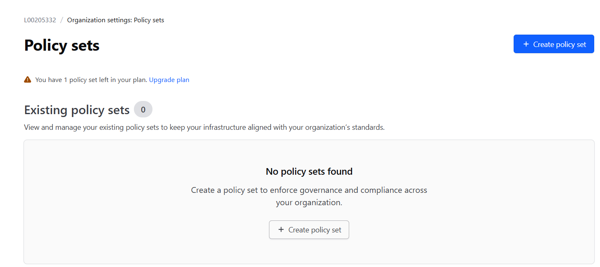 | 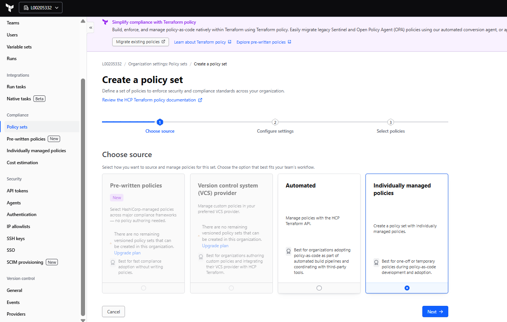 | 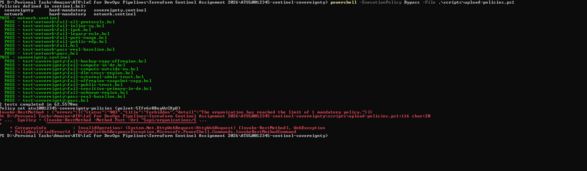 | 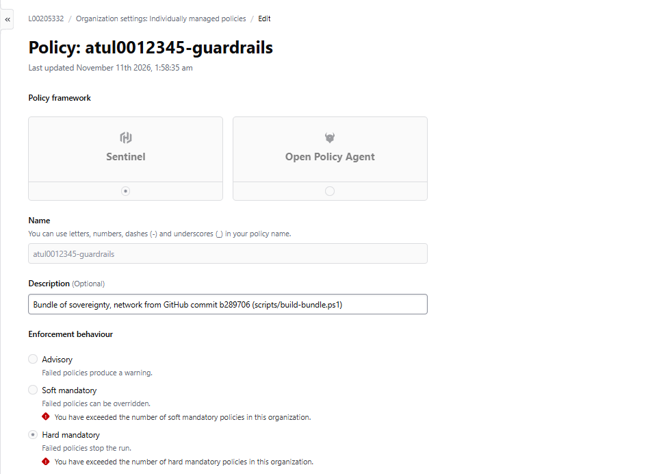 |

Cost guard-rail: a $10/month AWS budget alert was set before any real resource was created.

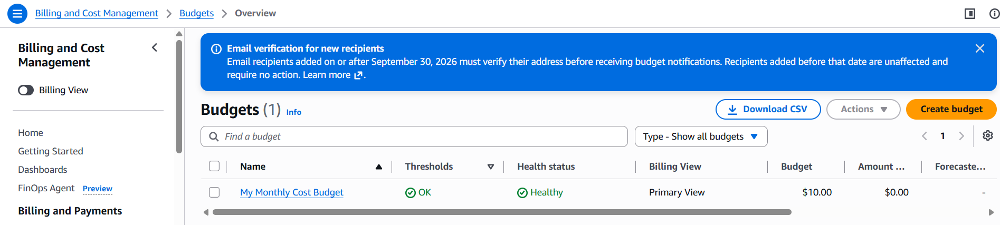

## HCP integration

The workspace is VCS-driven from this repo (working directory `terraform`, trigger `/terraform/**/*`, manual apply, speculative plans on PRs).

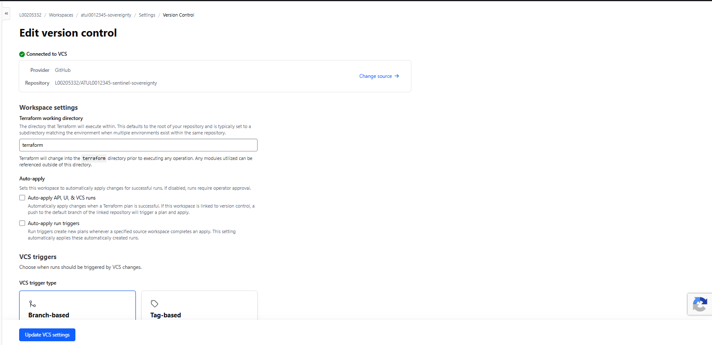
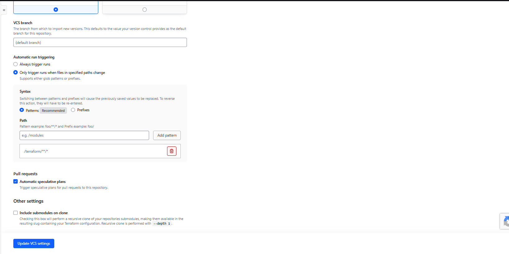

The policy set as it evolved: first `network` alone, then the bundle, then the bundle plus the advisory `instance_type` policy. Each description records the GitHub commit it was deployed from.

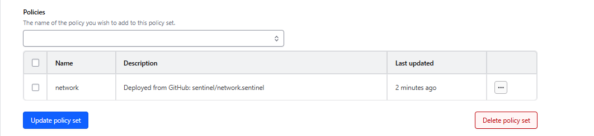
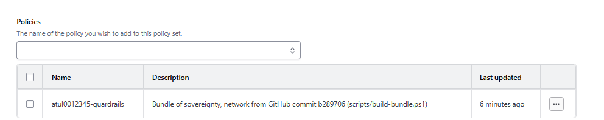
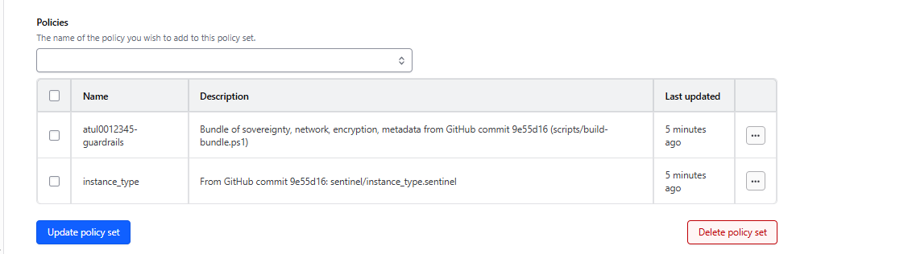

Policies are deployed from the repo by `scripts/upload-policies.ps1`: tests → bundle build → bundle tests → API upload.

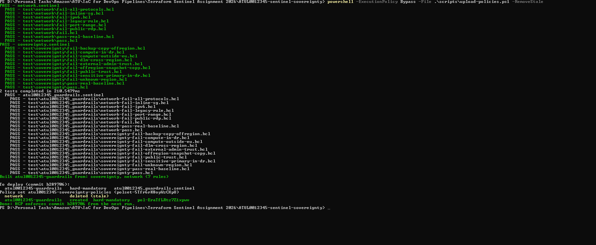

---

## Scenario 1: Compliant baseline (applied)

**Expected:** the plan passes every policy and is applied; real resources match the design (Ireland, with an encrypted backup copy in Frankfurt, nothing outside the EU).

**Before the apply:** the audit found nothing in any region.

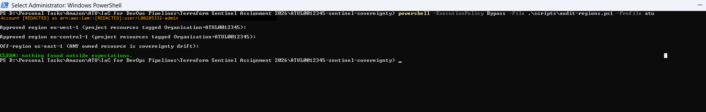

**Plan:** 23 to create. `region` is known at plan time (AWS provider v6), which the sovereignty policy relies on.

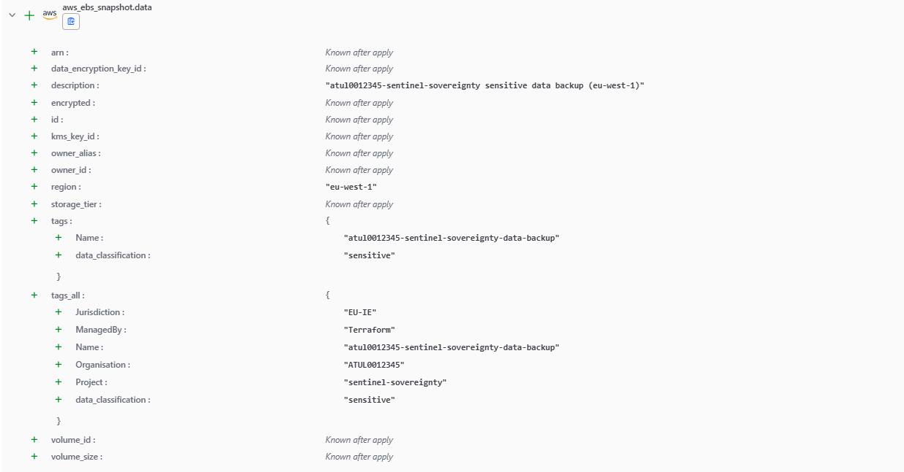
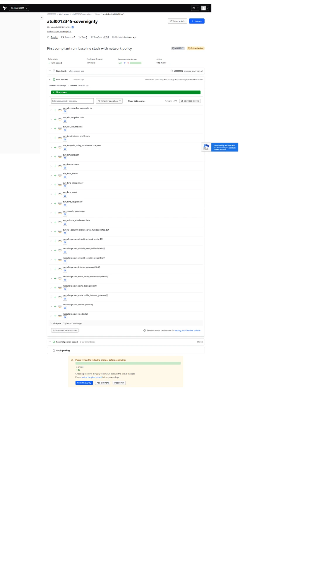

**Applied:** 23 created, after the policy check passed and the run was confirmed manually.

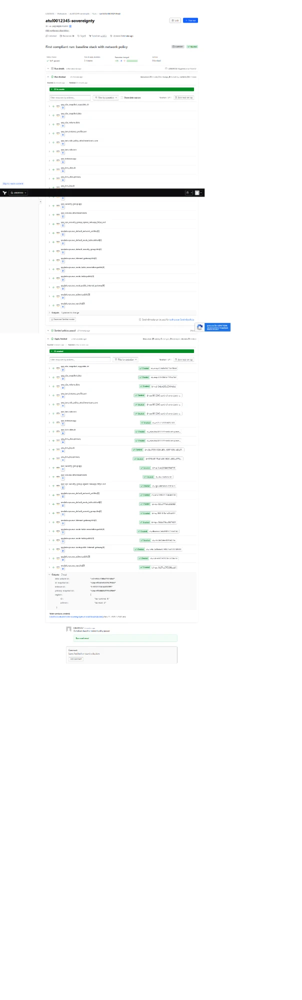

**After the apply:** 8 project items found, all in the approved EU regions; nothing in `us-east-1`.

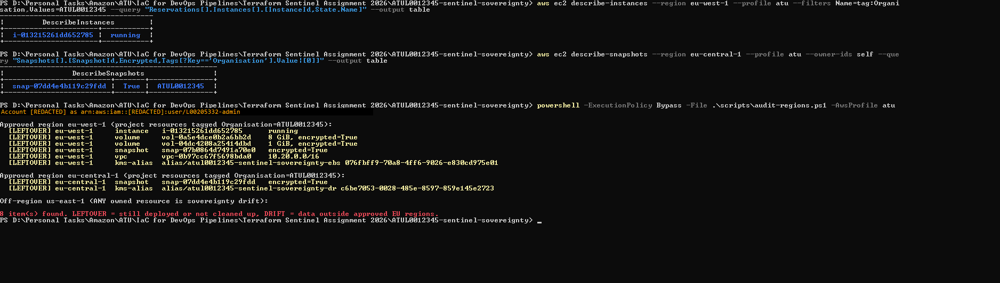

---

## Scenario 2: Sovereignty, DR copy outside the EU (PR #9): BLOCKED

**Change:** `dr_region = "us-east-1"`. **Expected:** `atul0012345-guardrails` (hard-mandatory) fails and the run can't be applied.

**Plan:** the DR KMS key, alias and snapshot copy are replaced in `us-east-1` (+3 / −3).

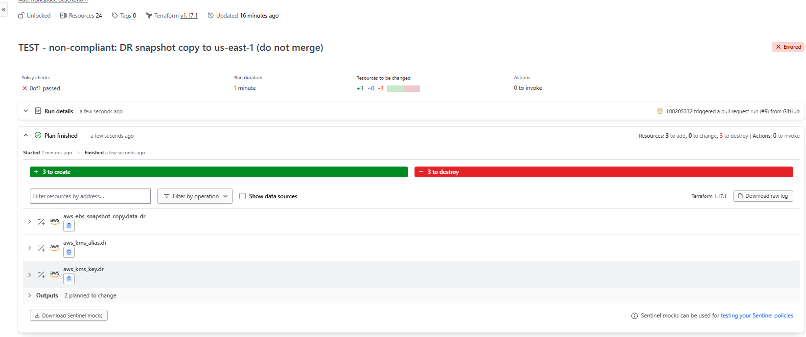

**Policy:** hard failed, with every violation listed in one run:
```
FAIL resources_in_approved_regions: aws_kms_key.dr is in us-east-1
FAIL resources_in_approved_regions: aws_ebs_snapshot_copy.data_dr is in us-east-1
FAIL resources_in_approved_regions: aws_kms_alias.dr is in us-east-1
FAIL sensitive_data_resident: aws_ebs_snapshot_copy.data_dr holds sensitive data in us-east-1 …
```

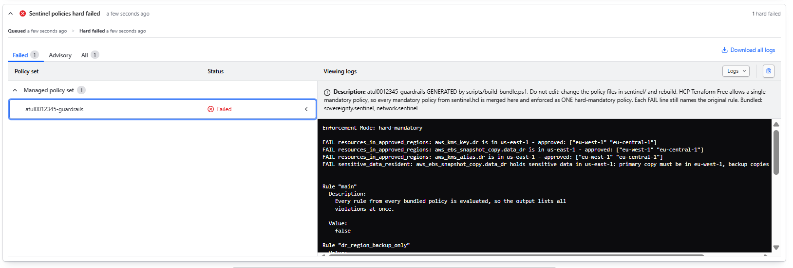

**GitHub:** the PR check failed. The PR was closed without merging.

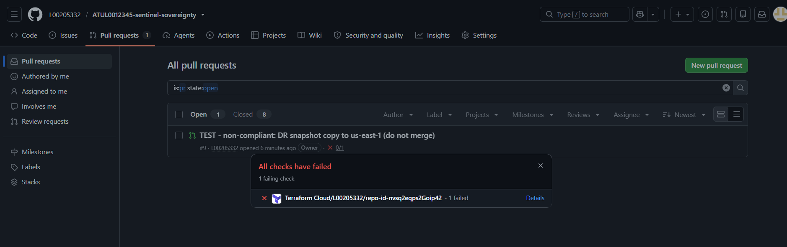

The real plan from this run is stored (redacted) in `sentinel/mocks/offregion-snapshot/` and replayed by `test/sovereignty/fail-real-offregion.hcl`, which reproduces the same four FAIL lines locally.

---

## Scenario 3: Unencrypted EBS volume (PR #12): BLOCKED

**Change:** `aws_ebs_volume.data` `encrypted = false`. **Expected:** `ebs_encrypted` fails.

**Plan:** the volume is replaced, together with its attachment, snapshot and DR copy (+4 / −4).

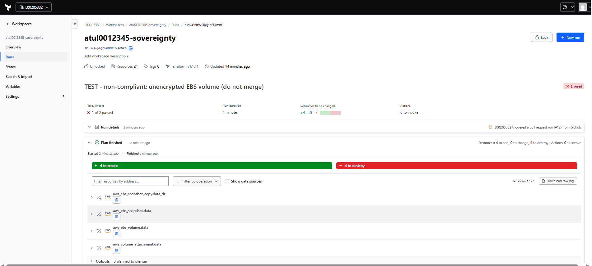

**Policy:** 1 of 2 passed. `instance_type` (advisory) passed; the guardrails policy hard failed with exactly one violation:
```
FAIL ebs_encrypted: aws_ebs_volume.data is not encrypted
```
`ebs_customer_managed_key` stayed **true**, because the key was still set in the code, which shows the two encryption rules are independent.

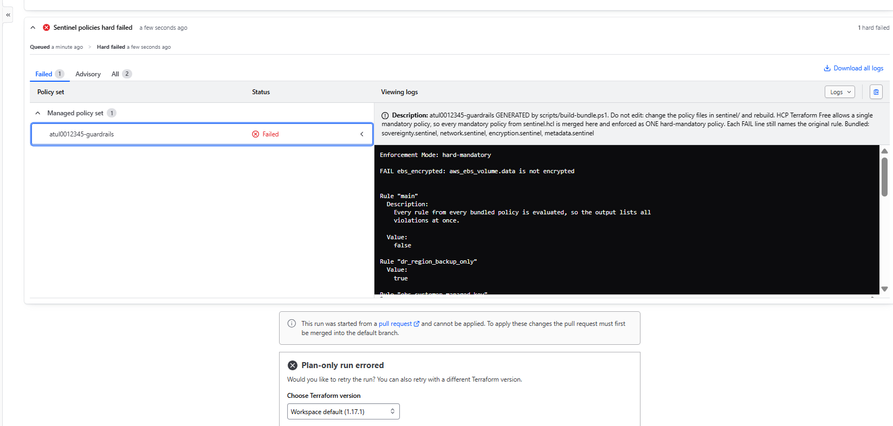

**GitHub:** the check failed, **but "Merge pull request" was still enabled**. Finding: a policy check gates the *apply*, not the *merge*. Branch protection requiring the HCP check is needed to stop non-compliant code reaching `main` (README §7.4).

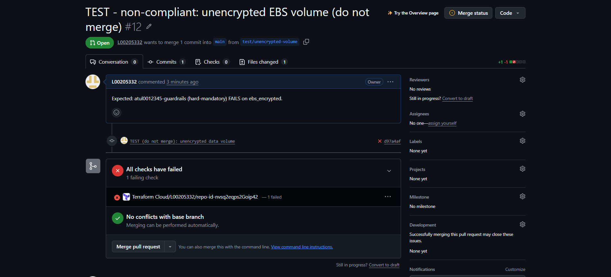

---

## Scenario 4: IMDSv1 allowed (PR #13): BLOCKED, and a policy bug found

**Change:** `http_tokens = "optional"`. **Expected:** `imdsv2_required` fails.

**Plan:** `aws_instance.app` is updated in place (~1).

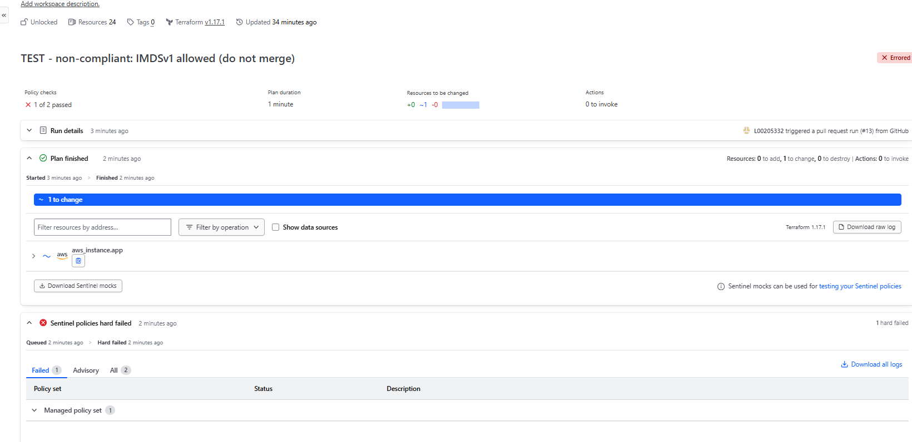

**First run:** correctly blocked, but it also showed a **false** failure:
```
FAIL imdsv2_required: aws_instance.app allows IMDSv1 (http_tokens = optional)      ← correct
FAIL imds_hop_limit_restricted: … http_put_response_hop_limit = 1, maximum allowed is 1   ← false positive
```
**Cause:** HCP passes plan numbers as floats (`1.0`), but downloaded mocks store them as ints (`1`), and the rule only accepted `int`. All 40 local tests passed, while every HCP run (compliant ones included) would have failed this rule.

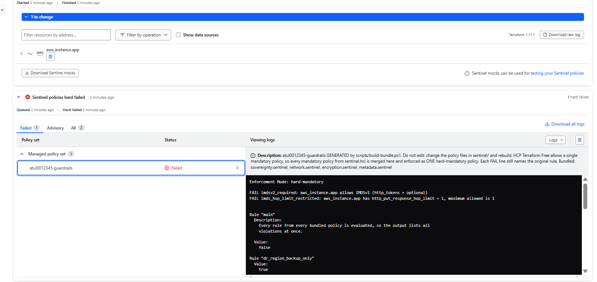

**Fix (PR #14):** the rule accepts `int` or `float`, and float regression tests were added for the metadata and network policies. Reverting the fix makes the new test fail with HCP's exact message.

**Re-run after the fix:** still blocked, now for the right reason only.

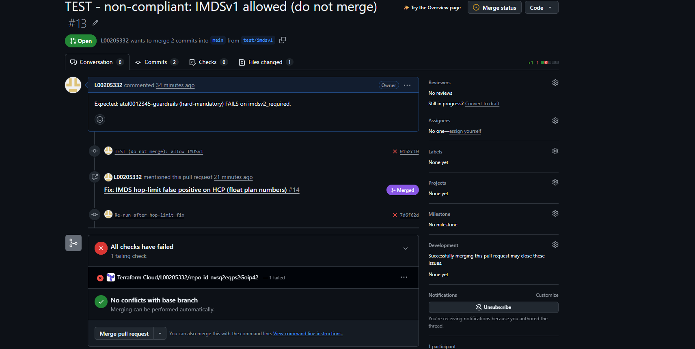
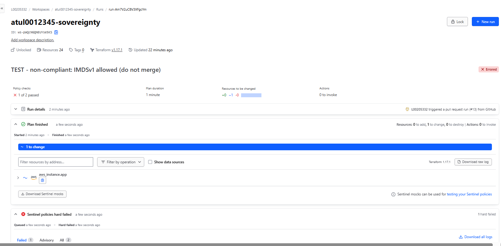
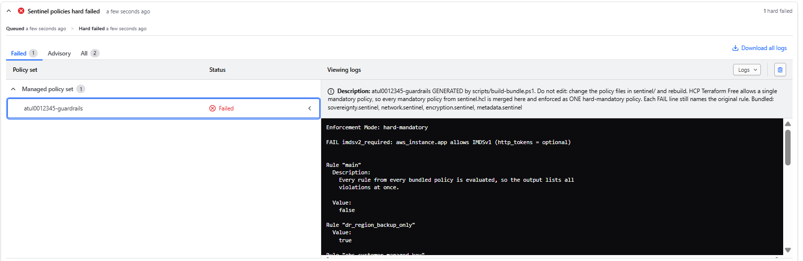

**Lesson:** mock-based tests are only as faithful as the mocks. A live run on the real platform is still needed.

---

## Scenario 5: Advisory, `t3.large` (test C)

_Pending. Expected: guardrails pass, `instance_type` advisory warns, the run is **not** blocked._

## Scenario 6: Drift, manual off-region copy

_Pending. Expected: a snapshot copied to `us-east-1` with the AWS CLI is invisible to Sentinel; `scripts/audit-regions.ps1` reports it as `DRIFT`._
